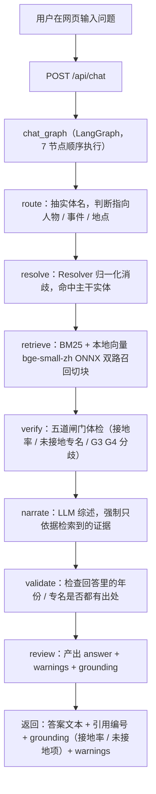
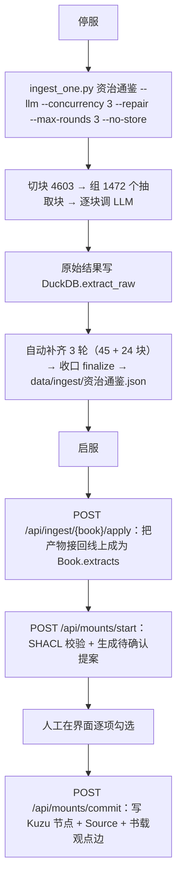
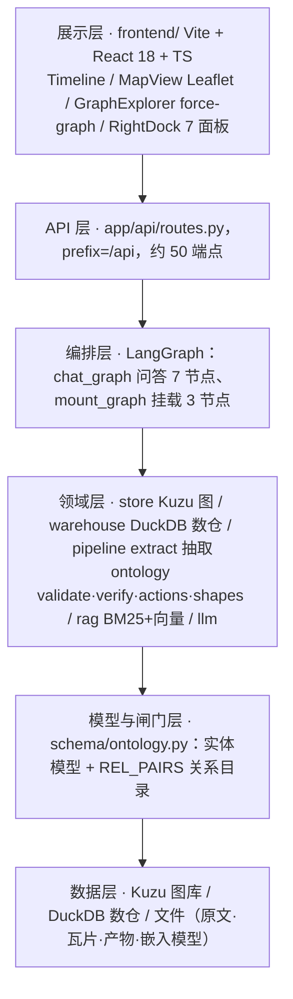
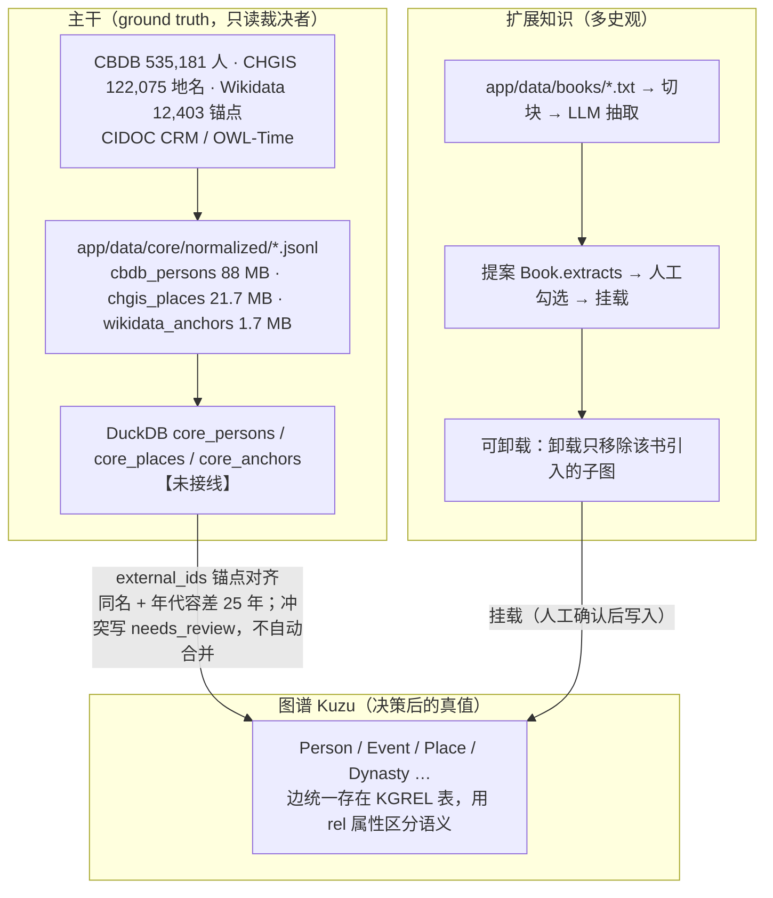
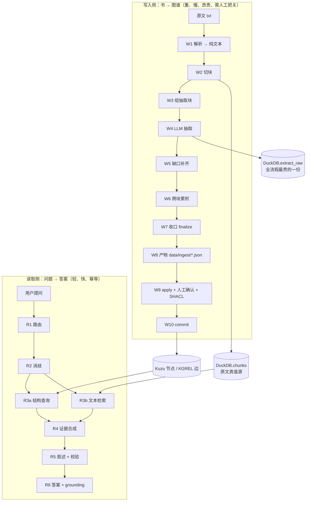
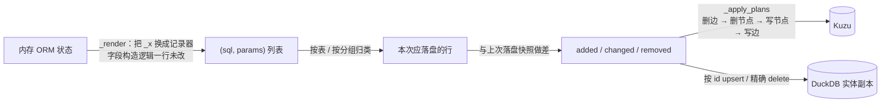
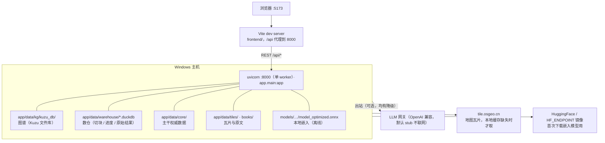

# ChronoSino 架构设计文档（4+1 视图）

> 项目：华夏时空 ChronoSino —— 面向中国史的「权威主干 + 多史观扩展」知识图谱与 RAG 平台
> 日期：2026-10-04　配套：`GUIDE.md`（原理与实操）、`DATA_LINEAGE.md`（数据血缘与备份）、`BUILD.md`（逐步构建）、`ONTOLOGY_ALIGN.md`（语义网对齐）
>
> 本文用 Kruchten 的 **4+1 视图**描述系统：
> **场景视图**（+1，串起全篇）· **逻辑视图**（领域模型与双源知识）· **进程视图**（运行时与并发）· **实现视图**（代码与依赖）· **部署视图**（物理拓扑与数据落地）。
>
> 文中标注含义：`【已接线】`=在线链路在用；`【未接线】`=代码已存在但无调用方；`【实测】`=本仓库跑出来的真实数字。

---

## 0. 一句话概览

ChronoSino 把知识分成**两层**：一层是**主干**（来自 CBDB / CHGIS / Wikidata 的权威史实，53 万人物、12 万地名），作为判定"是不是同一个人 / 这件事发生在哪"的 ground truth；另一层是**扩展知识**（《史记》《资治通鉴》等具体著作的记载），作为可挂载、可卸载、彼此并列的多史观表达。主干不进图库（只做字典式查询），图库里只放已对齐、已挂载的实体与边，靠 `provenance` 四级裁决（`core > seed > book > llm`）保证权威源永不被书籍/模型覆盖。

---

## 1. 场景视图（Scenarios，+1）

六个场景串起全部视图，后文每一节都能溯源到这里。

### S1 · 学习者问一个问题（主场景）



反幻觉的关键不在"提示词写得好"，而在 **`verify` 与 `validate` 两个节点会用闸门量化答案的接地程度**，把"这句没有出处"作为结构化字段返回，交由界面显式呈现（`app/graph/nodes.py` + `app/ontology/verify.py`）。

### S2 · 把一本书接入系统（构建场景，本轮刚跑完）



【实测】《资治通鉴》1472 块全部跑完，回退块 0 / 报错块 0 / 空块 68，全书提案 44447 条（人物 16145 / 事件 28302），单轮约 4.5 小时（并发 3，约 3–5 块/分）；第 10 步挂载走通，SHACL `conforms=true / violations=0`，**全书 44447 条一次性挂载成功**（16145 人物 + 28302 事件 + 44447 条书载观点边，与提案数严格相等），耗时 13.7 分钟，服务进程峰值 6.6 GB——不再需要按 TopN 砍提案，见 §4.4。

### S3 · 上传一本自己的书

`POST /api/library/upload`（FormData，`run_in_threadpool` 避免阻塞事件循环）→ `parse.py` 解析（PDF/TXT/EPUB/MD）→ 与 S2 同一条 `run_book` 管线，区别是 `Book.origin="upload"`，走 `align_mode="link"`：已在主干的人物不重复造节点，只生成"对齐"提案并挂上该书的说法与出处。

### S4 · 研究者核对某说法出自哪本书

实体详情 → 右栏「史料溯源」：`Source.level`（1 原始 / 2 现代史学 / 3 大众文学）+ `Source.from_book` + `Event.book_sources`，每条证据回溯到具体书名，并用 `dispute` 字段标注"这是《X》的作者解释框架，非学界定论"。

### S5 · Agent 提出写操作

Agent 不能直接改图。`app/agents/runtime.py` 把意图转成 `PendingOps` 待审批卡（`app/data/pending_ops.json`）→ `GET /operations` 列出 → 人工 `confirm/cancel` → 执行 → 落 `ActionLog`（`app/data/action_log.json`），支持**单步撤销**（`POST /actions/{seq}/undo`）。

### S6 · 主干对齐（权威源补 `external_ids`）

```
scripts/fetch_core.py        下载 CBDB sqlite / CHGIS / Wikidata SPARQL / CIDOC CRM / OWL-Time
scripts/extract_core.py      派生精简表 → app/data/core/normalized/*.jsonl（88 MB + 21.7 MB + 1.7 MB）
scripts/import_core.py --load  写入 DuckDB 三张表 core_persons / core_places / core_anchors
scripts/import_core.py --link  给已有 Person 补 external_ids["cbdb"]；交叉锚点才新建 provenance="core" 的节点
                               冲突一律写 core/needs_review.jsonl，绝不自动合并
```

【未接线】`core_*` 三张表目前**没有任何查询方**（全仓 grep 只命中脚本自身），也就是说检索与问答链路尚未真正消费这份主干字典。

---

## 2. 逻辑视图

### 2.1 分层



### 2.2 领域模型（本体）

`app/schema/ontology.py` 定义 **11 个实体模型**：

| 类别 | 模型 | 关键字段 |
|---|---|---|
| 主干四要素 | `Dynasty` `Event` `Person` `Place` | `Dynasty.group/lane` 支撑并立政权；`Event.date_confidence/route/from_book/book_sources`；`Person.aliases` |
| 证据 | `Source` | `level` 1 原始 / 2 现代史学 / 3 大众文学 |
| 书籍 | `Book` | `origin=builtin\|upload`、`mounted`、`accepted` 位图 |
| 提案 | `Extract` | `kind=person\|event\|link`、`new_id`（新建）/`target_id`（对齐） |
| 扩展三类 | `Institution`（机构/官职）`Artifact`（器物/碑刻/简牍）`Concept`（概念） | `Institution.kind=org\|post`；纪律：治世、事变归 Event，不入 Concept |

**统一治理字段 `_Governed`**（所有模型共有）：

- `external_ids: dict[str, str]` —— 外部锚点，键受白名单约束（wikidata / cbdb / chgis / tgn / geonames / periodo / viaf / bibframe / wikisource）
- `provenance: str` —— **冲突裁决的四档**：`core`（权威主干，最强）> `seed`（内置种子）> `book`（挂载书，代表单一史观，不可覆盖 core）> `llm`（模型抽取，最弱）
- `created_at / updated_at / version`

> 注意两个易混概念：**`provenance` 表示知识来源的可信等级**，`Book.origin` 表示这本书是内置还是用户上传，语义不同。

### 2.3 双源知识模型：主干 vs 扩展知识 ★

这是整个系统的设计核心，也决定了存储分工。



三条设计原则：

1. **主干不进图库**（`GUIDE.md` §1.4）：53 万人物塞进图库会把图撑爆且拖慢遍历；主干以字典表形态提供"对齐查询"，只有被书、被种子引用到的实体才在空间里落成节点。
2. **书籍永远是"观点"，不是"事实"**：挂载产生的节点带 `from_book`，事件默认写入 `dispute="挂载观点：代表《X》作者的解释框架，非学界定论"`，从模型层面堵死"把某本书的说法当成定论"。
3. **叠加不重建**：第二本起已是主干实体的人物不新建节点，只追加 `book_sources`，同一张实体卡呈现多来源说法，分歧由 G4 并列展示（见 `ONTOLOGY_ALIGN.md`）。

### 2.4 关系目录与 G1 闸门

写边是**唯一入口**`store.add_edge()`，受两重白名单约束：

- **`REL_PAIRS`**（`schema/ontology.py`）：显式列出全部允许的 `(起点标签, 终点标签)` 组合，共约 20 类 `REL_TYPES`（参与 / 任职于 / 师承 / 发生于 / 触发 / 奠定 / 书载观点 / 继承 / 包含 / 出土于 / 铭文录为 / 提及 / 创立 / 推行 / 盛行于 …）。
- **`store._REL_DDL`**：Kuzu 的关系表定义与 `REL_PAIRS` 互为镜像。

规则是：**关系名可以自由，端点组合必须合法**；端点不存在抛"端点不存在"，组合越界抛"非法端点组合"，以此杜绝悬空边（本仓库曾因 `_has_table` 探测逻辑错误导致整库被 DROP，已修）。

### 2.5 五道闸门

| 闸门 | 约束 | 落地位置 |
|---|---|---|
| G1 模式白名单 | 只有 `REL_PAIRS` 允许的组合能写边 | `store.add_edge()` |
| G2 证据绑定 | 每个实体/事件必须挂 `Source`（含 `from_book`） | `Event.book_sources` / `Person.book_sources` |
| G3 接地校验 | 回答里的年份、专名必须与证据对齐，输出接地率 | `ontology/verify.py` → `/api/chat` 的 `grounding` |
| G4 分歧并列 | 同一实体多来源冲突时并列展示，不擅自取一 | `verify.detect_disputes` / `Event.dispute` |
| G5 外部锚点 | `external_ids` 命名空间白名单，对齐 CIDOC / Wikidata 等外部标识 | `ontology/verify.py` + `ontology/shapes.py` |

另有 SHACL 形状校验（`pyshacl`）在**挂载前**运行：`mounts/start` 返回 `shacl.conforms`，如不通过可选择 `strict` 拒绝挂载。

---

## 3. 数据处理流程视图（Data Flow）

前两节回答"系统由什么构成"和"谁在什么时候跑"。这一节回答**数据形态如何一步步变形**：从一本 txt 到图谱里的节点和边，再到用户看到的一句有出处的回答。

系统有两条方向相反的数据流：

- **写入侧（W1–W10）**：书 → 图谱。重、慢、昂贵、需要人工把关。
- **读取侧（R1–R6）**：问题 → 答案。轻、快、幂等、可重复 call。



### 3.1 写入侧十道工序

| # | 工序 | 输入 → 输出 | 处理单元 | 落在哪 | 能否续跑 / 重算代价 |
|---|---|---|---|---|---|
| W1 | 解析 | 文件（PDF/TXT/EPUB/MD）→ 纯文本 | `ingestion/parse.py` `parse_document` | 内存 | 秒级 |
| W2 | 切块 | 纯文本 → 800 字/重叠 100 的 4603 个切块 | `ingestion/rag.py` `chunk_text` | **DuckDB `chunks`**（原文真值源） | 参数指纹漂移才重算 |
| W3 | 组抽取块 | 切块 → 2400 字/重叠 240 的 1472 个 piece | `bookrun._run_pass` | 内存（序列确定，不需落盘） | 免费 |
| W4 | LLM 抽取 | piece → 结构化 JSON（persons/events/links） | `ingestion/extract.py` `extract_llm` | **DuckDB `extract_raw`** + `ingest_progress` + `ingest_failures` | **块级续跑**；丢了要重烧钱（4.5 小时/本） |
| W5 | 缺口补齐 | 失败台账 → 重跑缺口块 | `--repair` / `--retry-rounds` | 同上 | 只补缺口，幂等 |
| W6 | 跨块累积 | 1472 份原始结果 → 去重后的候选集 | `pipeline.accumulate` / `_merge_person` / `_merge_event` | 内存 | 秒级 |
| W7 | 收口 finalize | 候选集 → 提案列表 | `pipeline.finalize` → `_to_proposals` | 内存 | **秒级**（`--finalize-only`，不调 LLM） |
| W8 | 产物落盘 | 提案 → `*.json` | `bookrun.run_book` | `app/data/ingest/<book_id>.json` | 秒级重建 |
| W9 | 应用与把关 | 产物 → 待确认提案 + SHACL 校验 | `POST /api/mounts/start` | `Book.extracts` | 分钟级，纯本地 |
| W10 | 挂载写图 | 勾选位图 → 节点 + 边 + 证据 | `store.commit_book` | **Kuzu `app/data/kg/kuzu_db`** | 卸载后重挂，分钟级 |

W2 与 W4 是**唯二的昂贵工序**：W2 的成果是原文权威副本，W4 的成果烧的是 LLM 额度。其余八道工序都能本地秒级/分钟级重算。**这条成本和重算边界决定了备份策略**（见第 6 节数据落地清单）。

### 3.2 数据形态逐段变形（真实例子）

以《资治通鉴》"神策将吏改官"一段走完全程，看数据怎么变形：

**① 原文**（`app/data/books/资治通鉴.txt`）

```
诏神策将吏改官皆先奏闻，状至中书然后检勘施行。
```

**② 切块**（DuckDB `chunks` 表一行）

```json
{"book_id": "资治通鉴", "idx": 1187, "text": "诏神策将吏改官皆先奏闻……", "embedding": [0.021, -0.114, …]}
```

切块保留**逐字原文**，是后续所有引文溯源的唯一依据，因此它是 DuckDB 侧的真值源（Kuzu 里不再存 Chunk）。

**③ 抽取结果**（DuckDB `extract_raw.payload`，模型一次性输出）

```json
{"persons": [{"name": "神策将吏", "aliases": [], "summary": "…", "confidence": 0.75}],
 "events":  [{"name": "神策将吏改官先奏闻", "year": 838, "place": "长安",
              "summary": "诏神策将吏改官皆先奏闻，状至中书然后检勘施行。", "confidence": 0.8}],
 "links":   [{"src": "神策将吏", "dst": "神策将吏改官先奏闻", "rel": "参与"}],
 "mode":    "llm"}
```

这一条是**最贵的数据**：它被原样保存，之后调阈值、调 TopN、补跑缺块都从它重算，不必再问模型。

**④ 提案**（`data/ingest/资治通鉴.json` 中的一条）

```json
{"kind": "event", "name": "神策将吏改官先奏闻", "summary": "诏神策将吏改官皆先奏闻……",
 "confidence": 0.8, "new_id": "资治通鉴_e27781", "target_id": null,
 "year": 838, "lon": null, "lat": null, "place": "长安"}
```

`new_id` 在这里定死：人物取归一化名（跨书天然对齐），事件取 `{book_id}_e{i}`（避免第二本书撞主键）。`target_id` 非空表示"对齐到主干已有节点"而非新建。

**⑤ 挂载后的图谱对象**（Kuzu）

```text
Event(id=资治通鉴_e27781, name=神策将吏改官先奏闻, year=838,
      dynasty_id=<按 838 年推导，而非全书统一>, place=长安, actors=[],
      from_book=资治通鉴, provenance=book,
      book_sources=[Source(level=1, work=《资治通鉴》, text=诏神策将吏改官…, from_book=资治通鉴)],
      dispute="挂载观点：代表《资治通鉴》作者的解释框架，非学界定论。")

KGREL: (资治通鉴) -[书载观点, confidence=0.8, from_book=资治通鉴]-> (资治通鉴_e27781)
```

注意三处设计：朝代由**事件年份**推导（《资治通鉴》跨十余朝，整本书标一个朝代会把纪年搞错）；坐标缺失一律 `None` 而不是 `0.0`（否则事件会被堆到几内亚湾）；每条都强制带 `dispute` 说明这是"某本书的观点"。

### 3.3 读取侧六道工序

| # | 工序 | 做什么 | 数据来自哪 |
|---|---|---|---|
| R1 | 路由 `route_node` | 判断问题指向人物/事件/地点，抽出实体名与应用意图 | 问题文本 |
| R2 | 消歧 `resolve_node` | `Resolver` 归一化 + 别名匹配 → 命中主干实体 id | Kuzu 实体 + 种子别名 |
| R3a | 结构查询 | 取该实体的属性、邻接边、同期事件 | **Kuzu**（`store`） |
| R3b | 文本检索 `retrieve_node` | BM25 + 本地向量（bge-small-zh ONNX）双路召回证据段落 | **DuckDB `chunks`** |
| R4 | 证据合成 | 按相关度取 Top-K，附带书名、层级、原文 | 合成 `evidence` |
| R5–R6 | 叙述与校验 `narrate → validate → review` | LLM 只依据 `evidence` 生成；`verify` 逐项核年份/专名是否接地 | `ontology/verify.py` |

关键分工：**结构化事实用 Kuzu，可引用原文用 DuckDB**——所以两条支路的合成才是"有出处"的来源。

### 3.4 控制数据（让流程可续跑、可审计的那些表）

数据加工之外的另一类数据是"过程台账"，它们自身不参与回答，但决定整条流水线是否可续跑：

| 表 / 字段 | 作用 |
|---|---|
| `ingest_progress(book_id, piece_idx, model)` | 块级进度；主键含 model，换模型自动重跑而不与旧结果混淆 |
| `ingest_failures(kind=error\|empty\|fallback)` | 失败台账：区分「没跑过 / 报错 / 抽到空 / 降级启发式」，补跑只补该补的 |
| `extract_raw(payload)` | 每块原始结果，四小时后唯一不可替代的产物 |
| `book_runs(stage)` | 单本书阶段：pending → chunked → extracting → prepared → mounted |
| `book_run_params(signature)` | 参数指纹：切块/抽取参数或源文件一变，旧进度与旧结果自动判定失效 |
| **写入顺序不变量** | 先落原始结果、再记进度，杜绝「进度说跑过、结果没落盘」的静默缺口 |

### 3.5 重算矩阵：改一个参数，要重跑到哪一步

| 改动 | 需要重做 | 代价 |
|---|---|---|
| 改 `max_persons/events`（TopN）或 `min_confidence` | W7 起：`--finalize-only` | 秒级，**不烧钱** |
| 改 `align_mode`（是否与主干已有实体对齐） | W7 起 | 秒级 |
| 重新勾选提案 / 重挂载 | W8 → W10 | 分钟级 |
| 换 LLM 网关或模型 | W4 起（新 model key 独立开进度） | **贵，等同重抽** |
| 改 `chunk_size` / `extract_size` / 换原文文件 | W2 起（参数指纹漂移，块边界已变） | **贵，全书重来** |
| 重建向量索引 | `scripts/embed_chunks.py` | 中（本地模型） |

一句话：**凡是只影响"怎么选、怎么排"的参数，都能从 `extract_raw` 秒级重算；凡是影响"怎么切、问了谁"的改动，就意味着重跑。**

### 3.6 流程不变量

流水线在任何时候都必须成立的性质（也是排错时的判断依据）：

1. **悬空边恒为 0**：写边前两端必须存在，且组合落在 `REL_PAIRS` 白名单内。
2. **每条提案必带 `summary` 与 `from_book`**：没有出处的东西不允许成为候选。
3. **先落结果、再记进度**：杜绝静默缺口。
4. **提案只增不减**：补跑只会让提案变多（`keep_best` 保护，产物变少时不覆盖旧产物）。
5. **冲突不自动合并**：主干对齐里遇到同名同期冲突一律写 `needs_review.jsonl` 交人工。
6. **`provenance` 单调不可逆**：`core` 权威源永不破 `book`/`llm` 覆盖。
7. **卸载可逆**：只移除该书引入的子图，不动其他书的数据。
8. **落盘前先自保**：`store._refuse_wipe()` 在"内存空但图库非空"时拒绝重建，防止误清全库。

## 4. 进程视图

### 4.1 进程/线程清单与互斥关系

| 运行体 | 形态 | 约束 |
|---|---|---|
| Web 服务 | uvicorn 单 worker（`--workers 1` 隐含约定） | 独占 Kuzu + DuckDB 写权限 |
| 离线 CLI（`ingest_one.py` 等） | 独立进程 | **必须停服**（同写在启动即退出） |
| 在线构建任务 | 服务进程内的 `threading.Thread` | 全局 `_INGEST_LOCK`，同一时刻只构建一本书（多请求 409） |
| LLM 抽取线程池 | `_run_pass` 的 `ThreadPoolExecutor` | `RunOptions.concurrency`，默认 6（本轮实测用 3） |
| 只读体检（`check_kuzu.py`） | 独立进程，`read_only=True` | 可不停服运行 |

### 4.2 单写者一致性

- `store._x()`：**Kuzu 连接非线程安全**，所有 Cypher 用 `self._lock`（RLock）串行化，即使在 FastAPI 线程池下也安全。
- `store.transaction()`：可重入临界区，保证"内存变更 + 落盘"是一个整体。
- `store._refuse_wipe()`：内存为空但图库仍有 Dynasty 数据时**拒绝重建**（防止误把图库清空），`_create_schema` 落盘前必调用。
- `warehouse.chunks` 是真值源（原文切块），Kuzu 侧不再存 Chunk。

### 4.3 LLM 调用的流量控制

`app/llm/base.py` 内的全局闸门：

- **最小间隔**：`_gate_lock` + `_MIN_INTERVAL`（默认 1.5 s，服务启动脚本默认改成 2 s）—— 该网关 RPS 配额极低，并发 ≥4 会 429 `rps exhausted`。
- **推理型模型必关思考**：`extra_body.thinking.type=disabled`，否则 token 全被 reasoning 吃掉、content 恒空；网关不认该参数（400）时自动降级重试且不消耗重试次数。
- **输出预算**：抽取用 `LLM_EXTRACT_MAX_TOKENS=8000`、输入上限 `LLM_EXTRACT_INPUT_CHARS=6000`（本轮由 bug 反推确立：输入 12000 字 + 4000 预算会把 JSON 截断，触发整块静默回退启发式）。
- **超时与重试**：`LLM_TIMEOUT=90`（网关会偶发挂死，实测有请求 >6 分钟无响应）、`LLM_MAX_RETRY=2`，空响应与 429 都按失败退避（429 直接退到 6 s 再指数翻倍）。

### 4.4 已实测的容量边界（本轮新发现）

| 现象 | 数据 | 结论 |
|---|---|---|
| 单块抽取耗时 | 13–25 s（并发 3 时约 2.4–5 块/分） | 一本书几千块意味着小时级任务，必须可续跑 |
| 提案规模 | 一本《资治通鉴》44447 条 | 远超默认 `max_persons/events=10000`，会被静默截断 |
| **挂载内存** | 全量重写时写 4.4 万条 → 峰值 17.7 GB → `bad allocation`；改为增量写后同类数据是 **6.6 GB** | 根因是 `save()` 的 `DROP TABLE` + 全量重写（写入量随书架累加），已改成差分写库（§4.5） |
| 挂载耗时 | 全量 44447 条 commit **13.7 分钟**；《史记》4917 条 1.6 分钟 | 单本挂载成本可接受；第二本书挂载只写自己的提案，不再重写前一本 |
| **大批量卸载** | 卸载 9000 条节点时，服务进程被原生层直接终止（无 Python 异常、无系统事件） | **待修**（§8）：卸载走的是数万条 `DETACH DELETE`，需改成分批删除 |

### 4.5 落盘机制：从全量重写到增量差分

`save()` 过去的语义是「`DROP TABLE` 全部表 → 按内存重建整库」。对原型够用，但有两个致命性质：写入量**随书架累加**（挂第 N 本书要重写前 N 本的全部节点与边），且每次都产生整库废页。实际后果就是上面那两行：挂 4.4 万条 OOM、库膨胀到 658 MB。

现在的流程是三层「差分」机制（见 `store.py`）：



关键设计：

- **快照**：`_kz_snap`（节点）/ `_kz_edge_snap`（边）记录"上次写进磁盘的内容"。服务从磁盘加载完之后立刻对齐快照，所以"没改动就 `save()`"是零写入。全部写成功后才推进快照——中途抛异常时快照不变，下一次能重算同一份差异。
- **顺序**：先删边、再删节点、再写节点、最后写边。边删完后，节点删除就不必级联扫描关系（`DETACH DELETE` 在上万条边上做级联代价很高）。
- **记录器接管**：渲染阶段把 `_x` 临时换成记录器，原先逐条写库的代码**一个字段都没改**就被复用到增量路径上，改动风险集中在差分调度那一层。

实测收益（同一份《资治通鉴》数据）：

| 指标 | 全量重写时期 | 增量写 |
|---|---|---|
| 无改动时 `save()` | 重写约 1.2 万条 | **0.33 s，零写入** |
| 挂 44447 条 | 失败（峰值 17.7 GB） | 成功，13.7 分钟，峰值 6.6 GB |
| 图库体积 | 658.7 MB（含大量废页） | 204.6 MB |
| 服务启动 | 6–10 分钟 | 25–161 s |

**踩过的坑**：Kuzu 严格校验入参——`DELETE` 语句只声明了 `$a/$b/$rel/$fb`，把整行参数（含 `conf`/`sids`）传进去会直接抛 `Parameter sids not found`；边的 SQL 里 `la`/`lb` 只用于拼表名，同样不能进参数字典。
| 事件 id 冲突 | 旧版 id 是裸 `e0/e1…`，与上一本书撞主键 | 已改为 `{book_id}_e{i}` 书级前缀 |
| 挂载失败会留脏状态 | `book.mounted=True` 在 `save()` 之前赋值，`save()` 抛错后内存已标记、图里却没数据；再次 `apply` 因此被 409 拒绝 | 挂载前先确认 `mounted`，脏则 `POST /api/mounts/unmount` 再重来 |

---

## 5. 实现视图

### 5.1 目录与模块职责

```
backend/
  app/
    main.py              FastAPI 入口；启动时按 INGEST_BOOKS 显式同步指定书（空则不同步，不再自动全量挂载）
    config.py            全部环境变量入口（load_dotenv override=True，.env 优先于系统环境变量）
    store.py             ★图谱真值源：内存对象 + Kuzu 读写 + add_edge 唯一写边口 + 挂载/卸载
    warehouse.py         ★数仓：DuckDB 单进程写；chunks(真值源)/entities/ingest_progress/extract_raw/ingest_failures/book_runs
    schema/ontology.py   实体模型 + REL_TYPES + REL_PAIRS（G1 白名单）
    ontology/
      validate.py        SHACL 校验（rdflib + pyshacl），挂载前置
      verify.py          G3 接地报告 / G4 分歧检测 / G5 命名空间规范化
      shapes.py          由 REL_PAIRS 自动派生 SHACL shapes
      actions.py         ActionLog + 确认卡，单步撤销
    ingestion/
      bookrun.py         单本编排唯一入口 run_book（切块→抽取→补齐→收口），离线/在线共用
      pipeline.py        累积去重 + finalize + TopN 裁剪 + 提案生成
      extract.py         启发式抽取 + LLM 抽取（含 JSON 截断容错、字段 null 兜底）
      mount.py           挂载 LangGraph：_prepare → _await_approval → _commit
      parse.py           PDF/TXT/EPUB/MD 解析
      rag.py             中文分词 + BM25 + 向量检索统一入口
      resolve.py         实体名归一化与消歧
    graph/               LangGraph 问答链路：builder/nodes/state（7 节点）
    api/routes.py        ~50 个 REST 端点
    llm/                 StubLLM（离线确定性）/ OpenAILLM / 本地 ONNX 嵌入
    agents/              工具注册表 + 运行时（写操作先落待审批卡，人工确认后才执行）
    data/seed.py         冷启动种子（朝代/事件/人物/地点/史料）
    data/books_sync.py   内置书同步（bids 为空不展开为全部）
frontend/
  src/api.ts            全部端点映射
  src/App.tsx           三栏布局（时间轴 / 地图 / 图谱 + 右 Dock）
  src/components/       RightDock(7 面板) · BookMount · OntologyNav · GraphExplorer · MapView · Timeline · AgentManager
scripts/                运维脚本（见 §6.3）
```

### 5.2 关键依赖

`kuzu==0.11.3`（嵌入式图库，单写者）· `duckdb==1.5.6`（数仓）· `fastapi==0.115.6` + `uvicorn[standard]` · `pydantic==2.10.4` · `langgraph==0.2.60`（两条状态机）· `rdflib==7.6.0` + `pyshacl==0.40.1`（本体校验）· `openai==1.59.6`（可选，默认 stub）· `pypdf` / `python-multipart`。

### 5.3 配置中心

`backend/.env`（不入 git，`backend/.env.example` 为模板）：

- 网关三组：`EXTRACT_*`（抽取，量大要便宜）/ `CHAT_*`（综述，要质量）/ `OPENAI_*`（兜底）
- 行为调优：**`LLM_DISABLE_THINKING` `LLM_TIMEOUT` `LLM_MIN_INTERVAL` `LLM_MAX_RETRY` `LLM_TEMPERATURE` `LLM_EXTRACT_INPUT_CHARS` `LLM_EXTRACT_MAX_TOKENS` `LLM_CHAT_MAX_TOKENS`**（换模型时只需改这些，见 `BUILD.md` §1）
- 注意 `load_dotenv(override=True)`：**`.env` 覆盖同名系统环境变量**，临时调参请直接改 `.env` 并重启。

---

## 6. 部署视图

### 6.1 物理拓扑（当前形态：单机 Windows）



外部依赖全部可降级：LLM 不配密钥即退化为 `StubLLM`（离线确定性回答），瓦片失效降级为透明占位图。

### 6.2 数据落地清单

| 资产 | 路径 | 体积 | 入 git | 重建代价 |
|---|---|---|---|---|
| 原始·瓦片 | `app/data/tiles/` | 1022.8 MB | ✅ | 极高（抓取困难，必须入库） |
| 原始·书 | `app/data/books/` | 71.9 MB | ✅ | 高 |
| 原始·模型 | `models/…/model_optimized.onnx` | 94.8 MB | ✅ | 中 |
| 主干派生表 | `app/data/core/normalized/` | ~111 MB | ✅ | 中（`fetch_core.py` + manifest 可重建） |
| 主干大件 | `app/data/core/raw/` | ~858 MB | ❌ | 脚本重抓（超 GitHub 100 MB 单文件限制） |
| 构建·数仓 | `app/data/warehouse/` | **594.2 MB**【实测】 | ❌ | **高（`extract_raw` 是烧钱的 LLM 结果）** |
| 构建·图库 | `app/data/kg/` | 204.6 MB【实测，增量写后】 | ❌ | 中高（重新挂载） |
| 过程产物 | `app/data/ingest/` | 4.1 MB【实测，缩到 9000 提案后】 | ❌ | 低（由数仓秒级重算） |
| 本机冷备份 | `backend/_backup/<时间戳>/` | 1180.7 MB【实测】 | ❌ | — |

一句话：**只有 `warehouse` 里的 `extract_raw` 是真正昂贵且不可替代的资产**，产物 JSON 与图谱都能从它重算；当前它靠 `backup_data.py` 做本机兜底（`--keep 3`），注意备份需停服后执行。

### 6.3 启停与运维脚本

| 脚本 | 作用 |
|---|---|
| `scripts/serve.ps1`（仓库根） | 一站式：`-Frontend` 同时起前后端、`-Status`/`-Stop`/`-Restart`/`-Minimized` |
| `backend/scripts/serve.py` | 用 WMI 拉起脱离进程树的常驻服务，日志 `backend/logs/serve.log` |
| `backend/scripts/run_bg.py` | 通用后台跑器（支持 `--config json` 规避命令行中文编码），日志 `backend/logs/<脚本名>.log` |
| `backend/scripts/backup_data.py` | 冷备份 kg + warehouse + ingest + core 元数据 → `_backup/<时间戳>/` |
| `backend/scripts/reset_library.py` | 走 HTTP 批量卸载回干净基线（需要服务运行） |
| `backend/scripts/check_kuzu.py` | 只读体检：节点规模 + KGREL 边类型分布（**不需要停服**） |
| `backend/scripts/ingest_one.py` | 单本增量构建 CLI（必须停服） |
| `backend/scripts/e2e_flow.py` | 端到端验收冒烟 |

### 6.4 部署约束速查

- **单 worker**：`kuzu` 单写者锁，禁止 `--workers > 1`，也不要让离线脚本与服各同时跑。
- **首次就绪 1–2 分钟**（加载图库 + 校验），健康检查 `GET /api/health`。
- 端口：后端 8000、前端 5173、可选 Kuzu Explorer 8001。
- 网络环境：外网抓取常被墙（GitHub/jsdelivr 曾超时），因此**瓦片、嵌入模型、主干派生表都选择入库**而非运行时下载。

---

## 7. 质量属性设计小结

| 属性 | 手段 |
|---|---|
| 反幻觉 | G2 证据绑定 + G3 接地率输出 + G4 分歧并列 + 挂载一律标注"非学界定论" |
| 引用完整性 | 单一 `add_edge` 入口 + `REL_PAIRS` 白名单 + 端点存在性校验（悬空边为 0） |
| 可续跑 | 块级进度落 DuckDB + 失败台账区分「没跑过/报错/空/回退」+ `--repair` 多轮补齐 + 参数指纹防漂移 |
| 可回滚 | `unmount` 卸载单本书子图；ActionLog 单步撤销 |
| 可审计 | `provenance` 四级 + `from_book` + `Source.level` + 每个节点带 `created_at/version` |
| 离线可用 | StubLLM + 本地 ONNX 嵌入 + 本地瓦片缓存；无密钥也能完整启动 |

---

## 8. 已知缺口与技术债

1. **【未接线】主干字典未接入链路**：`import_core.py --load` 能写 `core_persons/core_places/core_anchors`，但 `app/` 下无任何查询代码，S6 目前是"生产了数据但没人用"。
2. **【未接线】`EntityType` 枚举滞后**：只有 dynasty/event/person/place 四个成员，未覆盖已建模的 Institution/Artifact/Concept。
3. **【未接线】本体导出**：`scripts/export_owl.py`（→ chronosino.owl，含 CIDOC CRM / OWL-Time 映射）与 `validate_shacl.py --all` 仍标注"计划"。
4. **【已修】大批量卸载会让进程坠落**（原第 4 条）：原因是卸载走通用 diff，要为每条节点与边各发一条删除语句；而这本书产生的行都带 `from_book`，改为一条带属性过滤的语句整批清掉即可。详见 §8.1。
5. **【语义待澄清】`link` 提案恒为 0**：`_to_proposals` 只把能解析到主干的 link 转成提案，本书新实体的关系因此被丢弃；当前图谱的边实际是"书→节点"的书载观点边，而非抽取器给出的人物—事件关系。是否要把 LLM 抽出的 `links` 变成真正的实体间边，是一个待定的设计决策。
6. **【运维】产物与数仓均未入库**：二者都标 ❌，`extract_raw` 只靠本机备份保护；是否改为可入库的 jsonl 导出，尚未拍板。
7. **【已修】挂载失败会留下半挂载脏状态**（原第 7 条）：`mounted` 标记已挪到本体真正落盘之后再写，详见 §8.1。
8. **【已修】DuckDB 实体投影副本被静默擦成空表**（原第 8 条）：`replace_entities` 原为「先 DELETE 全表再插」，一旦载入侧出异常（且异常被上层 `try/except` 吞掉）就会留下 0 行而无人察觉，`entities` 正是这样空的。现已改为：**空 rows 一律不删表**、`_sync_entities_to_warehouse` 不再静默吞异常、全量重灌前若「图里有实体却算出空行」则跳过。实测能重灌回 48704 行。
9. **【已修】语义边稀疏**（原本 48673 条边里 48620 条是「书载观点」、`link` 提案恒为 0）：抽取器其实产出了 51635 条关系，但旧逻辑要求关系目标必须能解析到主干实体，于是全被丢弃。现已让关系两端解析到**本次新建的实体**，详见 §8.2。

### 8.1 挂载 / 卸载：实测出的三条硬约束

《资治通鉴》44447 条提案（人物 16145 / 事件 28302）是练到目前为止最大的一副数据，把 Kuzu 的几个脾气逼了出来：

| 结论 | 实测依据 |
|---|---|
| **挂载：逐条写与批量写在内存上没有差别** | 同一数据量、同一 buffer pool 下，逐条 `execute` / 批量 `UNWIND` / 逐条+周期性 `CHECKPOINT` 三者无差别地撑爆；瓶颈是单次提交规模，不是写法 |
| **卸载：必须按 `from_book` 整批删，且删完立刻重开连接** | 走通用 diff 要发 9 万条语句（实测 ≥8 分钟、3.6GB，最后仍被原生层打死）；改成 2 条属性过滤语句后 **2.7 秒**完成。但**执行批量删除的那条连接会被毒化**——紧接着再扫一次 KGREL 表就会把进程打死（无异常无堆栈，必现）；另一个进程打开同一份库完全正常，说明数据没坏、坏的只是连接内存态。因此 `_purge_book_disk` 之后必须 `_reset_kuzu_connection()` |
| **节点更新不能用 `DETACH DELETE` + 重建** | 更新 Book 行时，它名下 4.4 万条关系刚被整批删掉，`DETACH DELETE` 扫邻接表时把进程打死。改为原地 `SET` 各属性（Kuzu 支持参数化 SET，但**不接受多余参数**，多传就报 `Parameter X not found`） |

修复后的闭环（实测）：卸载 **72–84 秒**，节点 `-28302 / -16145`、边 `-44447`，精确回到挂载前基线（Event 2934 / Person 1314 / 边 4227），卸载后查询全部正常；重新挂载耗时 15.5 分钟，`16145 + 28302 = 44447` 与提案数一致。

> 附注：原始库的数字是 `16144 + 28302 = 44446`，比提案数少 1——旧写法静默丢掉了一条提案；现在不再丢。

### 8.2 语义边：从「星形图」到连通图

**问题**：《资治通鉴》第一次挂上去时，48673 条边里有 48620 条是「书→节点」的书载观点边，实体与实体之间几乎没有边——拿到 31236 个事件却答不了「谁参与了哪件事」。

**根因**：抽取器其实一直在产出关系（`accumulate` 里 `links` 累计 **51635** 条），但 `_to_proposals` 生成 link 提案时要求「目标必须能解析到主干实体」；而全书新增的实体天然不在主干里，于是 51635 → **0**。

**改法**：关系两端先从**本次新建的提案**里找实体（名字归一化后匹配），找不到再退回主干解析；两端都落得到实体才生成 `kind="relation"` 提案，`_commit_locked` 用它落成真正的 KGREL 边。端点缺一个就丢弃——不进悬空边。

**结果**（同一本书，未重跑 LLM，仅 `--finalize-only` 重算提案）：

| 指标 | 修复前 | 修复后 |
|---|---|---|
| 提案数 | 44447（人 16145 / 事 28302） | **83894**（+39447 条关系） |
| 边总数 | 48673 | **83947** |
| 书载观点边占比 | 48620 / 48673（99.9%） | 44447 / 83947（**53%**） |
| 语义边 | ≈14 条 | **39447 条** |
| 挂载耗时 | 13.7 分钟 | 24.9 分钟（服务进程峰值 10.7 GB） |

语义边分布（top）：`参与 23025 · 触发 3176 · 任职于 1994 · 推行 490 · 发生于 346 · 杀 314 · 任命 242 · 父子 214 · 谏 146 · 劝谏 117`。抽查「卫鞅」的一度邻域，`参与/推行` 已能把它与 10 余个事件连起来。

**代价与限制**：
- 提案列表从 4.4 万涨到 8.4 万，挂载界面改为「只渲染前 300 条供抽查」，勾选位图仍按全量提交。
- 关系名由 LLM 自由给出（未做词表归一），像 `杀 / 谏 / 劝谏` 这类同义或近义关系没有合并；如需更干净，可加一层关系词规范化映射。
- SHACL 体检曾因「数据图按 name 标识节点、关系边按 new_id」的错配把新关系整批判为违规（584972 处），已在 `data_graph_from_proposals` 里对齐两套 id，并且只体检两端都在这批提案内的关系。

---

## 9. 附录 · 文档索引

| 文档 | 回答什么问题 |
|---|---|
| `docs/ARCHITECTURE.md`（本文） | 系统怎么分层、数据怎么流转、进程怎么协作、如何部署 |
| `docs/GUIDE.md` | 设计原理（主干/扩展两层、CIDOC 对照）+ 从零构建实操 + 常见坑 |
| `docs/DATA_LINEAGE.md` | 数据血缘总图、入库/不入库总账、备份与恢复 |
| `docs/BUILD.md` | 逐步构建命令（离线 CLI / 在线 API 两条路径）、LLM 网关坑、补齐机制 |
| `docs/ONTOLOGY_ALIGN.md` | 与 CIDOC CRM / OWL-Time / Wikidata / CBDB / CHGIS 的字段级对齐 |
| `docs/PLAN.md` | 路线图与待办议题（含史家 Agent 与版权考量） |
