# 数据血缘与构建手册（本体 · 图谱 · RAG · 界面 · Agent）

> 定位：一篇讲清「数据从哪来、变成什么、存在哪、进不进版本库、后续怎么继续构建、界面和 Agent 怎么用」，并给出**字段级数据字典与跨库关联键**（§10）。
> 配套：`docs/PLAN.md`（总体方案）、`docs/BUILD.md`（逐步构建操作）、`docs/ONTOLOGY_ALIGN.md`（外部本体对齐与闸门）。
>
> 路径约定：下文 `app/data/**` 均指**数据目录**，默认 `backend/app/data`，可用环境变量
> `CHRONOSINO_DATA_DIR` 整体挪盘（各模块一律经 `config.DATA_DIR` 取路径）。
> **当前实例指向 `C:\agent-history-data`**（D 盘空间不足时迁出，见 `backend/.env`）。

---

## 0. 一句话概览

**Kuzu 图库存「是什么」（实体与语义关系，真值源），DuckDB 数仓存「怎么来的」（原文切块、LLM 抽取结果、进度台账）与检索副本；权威源（CBDB/CHGIS/Wikidata/CIDOC/OWL-Time）是主干，书籍（《史记》《二十四史》《资治通鉴》…）是挂在主干上的扩展知识。**

---

## 图索引（13 张）

| 图 | 位置 | 看什么 |
|---|---|---|
| 数据血缘总图 | §1 | 五层：源头 → 派生 → 真值 → 检索 → 消费 |
| 分层与读写路径 | §1.1 | 哪些进程写哪份存储、谁读谁 |
| 单本构建流水线 | §3.1 | 切块 → 抽取 → 收口 → 产物（含容错分支） |
| 单本构建时序 | §3.2 | 与数仓 / LLM 的读写先后顺序 |
| 挂载时序 | §3.3 | apply → start → 人工勾选 → commit |
| 五道闸门 | §3.3 | G1–G5 分别卡在哪一步 |
| 卸载与重挂 | §3.4 | 先清磁盘、后改内存，不存在半成品 |
| Store.save 内部 | §3.5 | 差分写 + 每 2000 行重开连接 |
| RAG 检索数据流 | §4.1 | 向量 → BM25 回退 → 接地校验 |
| Agent 审批时序 | §7.1 | 确认卡 → 复核 → 执行 → undo |
| 备份与恢复 | §8 | 停服 → 备份 → 覆盖 → 验收 / 回滚 |
| 图库模式 | §10.1 | 9 张节点表与 24 种边名 |
| 跨库关联键 | §10.3 | Kuzu ↔ DuckDB 的外键与副本关系 |

---

## 1. 数据血缘总图

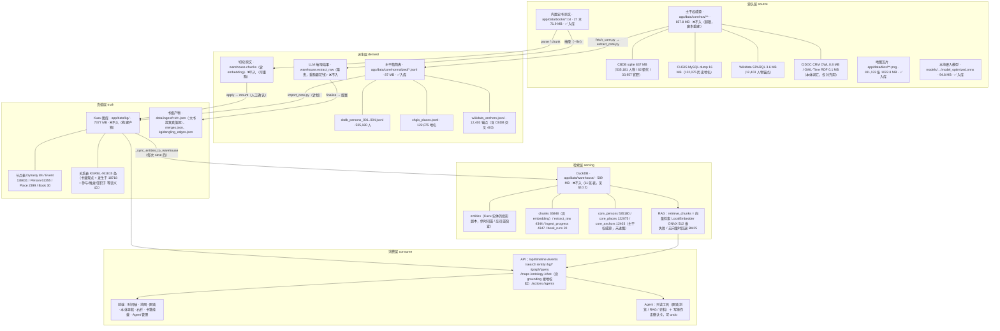

### 1.1 分层与读写路径（谁写、谁读）

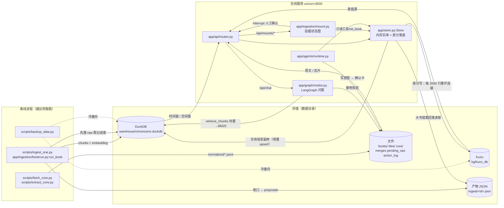

### 入库 / 不入库总账

| 类别 | 目录 | 体积 | 入库 | 重建代价 |
|---|---|---|---|---|
| 原始·瓦片 | `app/data/tiles/` | 1022.8 MB | ✅ | 极高（抓取困难，必须入库） |
| 原始·书 | `app/data/books/` | 71.9 MB | ✅ | 高 |
| 原始·模型 | `models/` | 94.8 MB | ✅ | 中 |
| 原始·主干大件 | `app/data/core/raw/` | 857.8 MB | ❌（CBDB 单文件 837 MB > GitHub 100 MB 硬限） | 中：`fetch_core.py` 按 `manifest.json` 重下 |
| 派生·主干精简 | `app/data/core/normalized/` | 87 MB | ✅ | 低：`extract_core.py` |
| 构建·图库 | `app/data/kg/` | 7377 MB | ❌ | 中高（可从数仓 `extract_raw` 重挂） |
| 构建·数仓 | `app/data/warehouse/` | 592 MB | ❌ | **高**（`extract_raw` 是 LLM 调用结果） |
| 过程产物·提案 | `app/data/ingest/` | 144 MB | ❌ | 低——**只要 `extract_raw` 还在**，收口即可重出；`extract_raw` 丢了才要重跑 LLM（贵） |
| 过程产物 | `library/`、`merges.json`、`pending_ops.json` | <1 MB | ❌ | 低 |

---

## 2. 构建路径 A：本体主干（先立骨架）

主干 = 权威源，不来自任何一本书；书籍只是挂在它上面的证据与观点。

```bash
# 1) 抓取原始权威数据（CIDOC / OWL-Time / Wikidata / CHGIS / CBDB）
python scripts/fetch_core.py                    # 并发抓取，断点续传，写 manifest.json
python scripts/fetch_core.py --discover         # 只探测可达性

# 2) 派生精简表（统一字段，体积小、可 diff、入库）
python scripts/extract_core.py                  # → core/normalized/*.jsonl
python scripts/extract_core.py --only cbdb --limit 2000   # 试跑

# 3) 导入（计划中：scripts/import_core.py）
#    · 主干大表 → DuckDB（core_persons / core_places / core_anchors）
#    · 图谱只连「已对齐」的实体：Wikidata↔CBDB 锚点（403）+ 与已挂载书实体同名同期者
#    · 实体新增 external_ids{wikidata,cbdb,chgis} 与 origin=core|book
```

对齐规范见 `docs/ONTOLOGY_ALIGN.md`：Person→CIDOC `E21`、Event→`E5`、Place→`E53`、参与→`P11`；时间区间映射 OWL-Time `time:Interval` / `time:Instant`（已核实：OWL-Time 里没有 `TimeSpan`，那是 CIDOC `E52` 的叫法）；外部锚点统一放 `external_ids`。

> 现状提醒（已更新）：26 史全部挂载完成——KGREL 共 **461815 条**，其中 18,718 条是
> 地名 assimilation 补的 `Event-发生于->Place`，其余为书载观点与参与 / 触发 / 任职于 等语义边。
> 仍有 **29 条悬空边**（种子用拼音 id `xiangyu`，而库里节点是中文名 id `项羽`），记在 `kg/dangling_edges.json`，不影响查询。
> link（书载观点对齐到主干实体）提案曾恒为 0：主干快照只有名字集合、缺「归一化名 → id」映射，`_resolve_target` 永远匹配不上。已修（`known_from_store` 补 `person_name_ids` / `event_name_ids`），《资治通鉴》link 提案 0 → 62120 条。

---

## 3. 构建路径 B：知识图谱（每本书叠加）

### 3.1 单本构建流水线

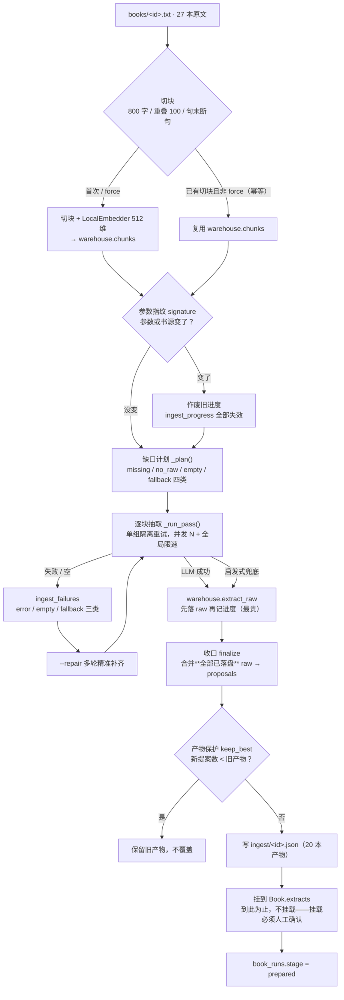

### 3.2 单本构建的读写时序

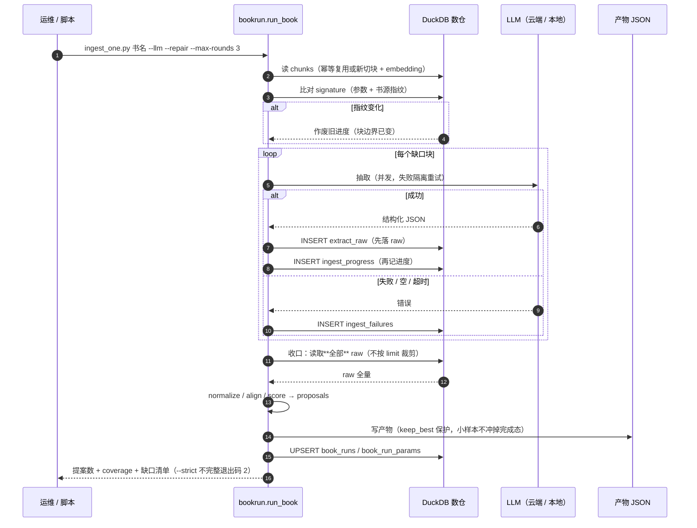

### 3.3 挂载：人工确认后才进图

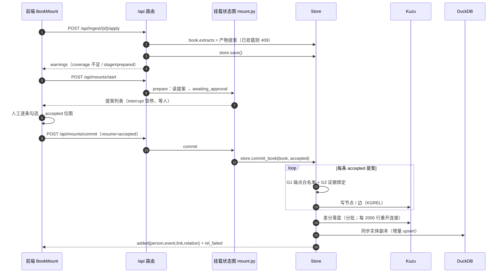

五道闸门在挂载与消费侧的位置：

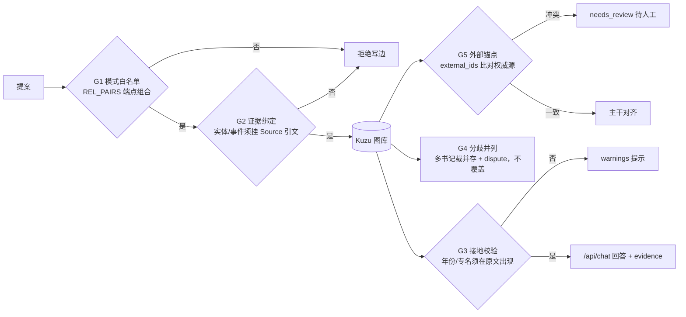

### 3.4 卸载与重挂（唯一会造成不一致的路径）

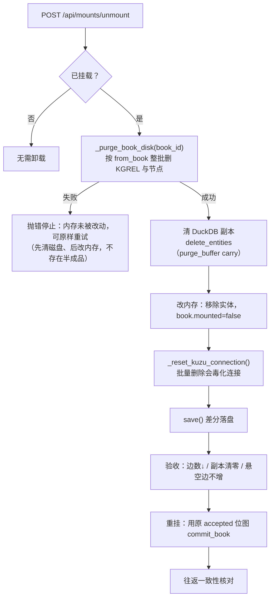

实测（《资治通鉴》，8.4 万边）：卸载 **90 秒**、重挂 **21 分钟**，进程存活；边 83947→32→83926，该书副本实体 44447→0→44447，悬空边恒为 29。

### 3.5 Store.save 的写盘内部

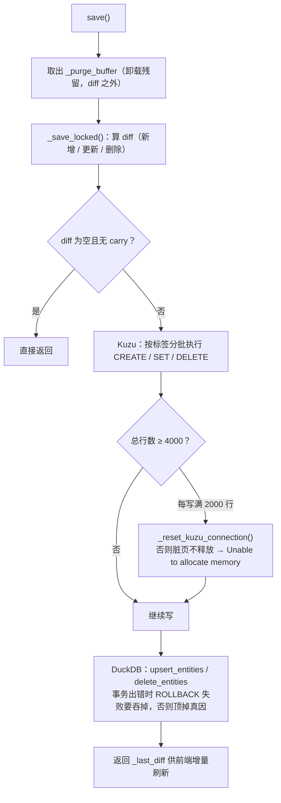

- 离线（推荐，停服）：`python scripts/ingest_one.py <book> --llm --repair --max-rounds 3 --strict --retry-rounds N --reset-failed --no-store`
- 在线：`POST /api/ingest/{book_id}`（后台单任务，409 表示已有任务在跑）→ `/api/ingest/{id}/apply` → `/api/mounts/start`（看 `warnings`）→ `/api/mounts/commit`
- 队列与进度：`/api/books/queue`、`/api/books`（带 `ingest` 与 `integrity`）

**可靠性与完整性保障**（已实现，详见 `docs/BUILD.md` §3.6）
单组隔离重试 · 失败台账（error/empty/fallback 三类）· 缺口计划（missing/no_raw/empty/fallback）· `--repair` 多轮补齐 · 收口合并全量 raw 不按 limit 裁剪 · **先落 raw 再记进度** · 产物保护（`keep_best`，新提案少于旧产物不覆盖）· 参数指纹（改参数自动作废旧进度）· Ctrl+C 先收口再退出 · `--strict` 不完整退出码 2 · 状态保护（小样本不冲掉已完成状态）。

**五道闸门**
- G1 模式白名单：写边必须过 `REL_PAIRS`（`store.add_edge`）
- G2 证据绑定：实体/事件必须挂 `Source` 引文
- G3 接地校验：`/api/chat` 返回 `grounding`，年份/专名必须在原文出现
- G4 分歧并列：同一事件多书记载并列 + `dispute` 注记，不覆盖
- G5 外部锚点：`external_ids`（wikidata/cbdb/chgis/tgn/geonames）与权威源比对；冲突进 `needs_review`

---

## 4. 构建路径 C：RAG（让回答能溯源）

| 环节 | 实现 | 位置 |
|---|---|---|
| 切块 | `chunk_text()` 800 字 / 重叠 100，句末断句 | `app/ingestion/rag.py:16` |
| 分词 | `tokenize()`（BM25 用） | `app/ingestion/rag.py:49` |
| 嵌入 | `LocalEmbedder`（ONNX `bge-small-zh-v1.5`，512 维，本地离线）→ 云端兜底 | `app/llm/local_embed.py:26`、`app/llm/base.py:128` |
| 向量存放 | **DuckDB `chunks.embedding`**（Kuzu 不再存 Chunk） | `app/warehouse.py:49` |
| 检索 | `retrieve_chunks()`：向量 `vector_search()`（余弦）→ 无向量/异常回退 BM25 | `app/ingestion/rag.py:136/121/63` |
| 接入问答 | `retrieve_node()` 把命中块转成 `Source` 证据；`verify/narrate/validate/review` 节点强制引用编号 `[n]` | `app/graph/nodes.py:43-162` |
| 对外 | `/api/chat` 返回 `answer` + `evidence` + `grounding` + `warnings` | `app/api/routes.py:532-576` |

### 4.1 检索与问答数据流

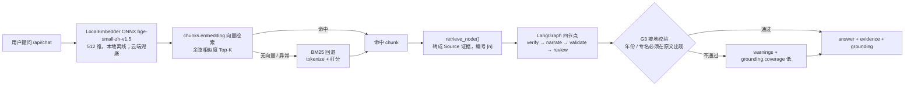

自检：`python scripts/selftest_ingest.py`（解析与 RAG 冒烟）。

---

## 5. 每加一本书的标准流程（叠加，不重建）

```bash
# ① 停服，离线抽取（可断点续跑、可多轮补齐）
python scripts/ingest_one.py 资治通鉴 --llm --repair --max-rounds 3 --strict

# ② 启服，接回线上并挂载（人工确认）
POST /api/ingest/资治通鉴/apply
POST /api/mounts/start      # 看 warnings：coverage < 100% 会提示
POST /api/mounts/commit

# ③ 可选：新实体与主干对齐（产出 external_ids 候选 → 人工确认 merges）
python scripts/import_core.py --link

# ④ 验收
python scripts/e2e_flow.py --book 资治通鉴            # 只读冒烟
python scripts/e2e_flow.py --book 资治通鉴 --chat     # 连对话与接地一起验
```

事件在 `commit_book` 时按年份用 `dynasty_at(year)` 自动归朝，因此《资治通鉴》这类跨十余朝的通史也能正确落位。

---

## 6. 界面怎么用

主壳 `frontend/src/App.tsx` 负责编排，UIAction 执行器把后端动作回放成界面变化。

| 面板 | 文件 | 用法 |
|---|---|---|
| 时间轴 | `components/Timeline.tsx` | 按年份浏览事件；车道展示并立政权；点事件开右栏详情 |
| 地图 | `MapView.tsx`、`MapGallery.tsx` | 按朝代切底图（18.1 万张本地瓦片），叠加事件地点 |
| 图谱 | `GraphExplorer.tsx` | 浏览实体与语义边，做子图展开 |
| 本体导航 | `OntologyNav.tsx` | 按本体类型（朝代/事件/人物/地点…）浏览主干 |
| 右栏 | `RightDock.tsx`（`onto/detail/source/books/agents/arch/ask`）+ `SidePanel.tsx` | 详情、引文原文、书籍、Agent、架构图、问答 |
| 书籍挂载 | `BookMount.tsx` | 上传/入库/抽取/应用/挂载全流程 |
| Agent 管理 | `AgentManager.tsx` | 注册 Agent、授权工具、查看待审批确认卡 |

服务启动：`powershell -File scripts/serve.ps1`（后端 8000；加 `-Frontend` 拉前端 5173）。

---

## 7. Agent 怎么用

- 注册与授权：`/api/agents*`（`app/api/routes.py:1088-1141`）；运行时 `app/agents/runtime.py:run_agent():197`
- 只读工具：图谱浏览、RAG 检索、史料读取（`_read_context():128`）
- **写操作不直接落地**：LLM 在【OPS】段提出写意图（`_split_ops():258`）→ 生成确认卡 `pending_ops`（`app/data/pending_ops.json`）
- 审批执行：`POST /api/operations`（confirm/cancel，`routes.py:1145`）→ `confirm_operation():298` 复核「Agent 仍存在 / 当前授权 / 目标存在」后才执行（`_EXECUTORS`：mount/unmount/delete，`:332-375`），并写 `action_log`
- 撤销：`/api/actions` 与 `POST /api/actions/{seq}/undo`（`routes.py:1023-1030`），动作类型与逆动作定义见 `app/ontology/actions.py:41/67`

三者区别别混淆：
- `proposals` = 入库抽取出来的**史料提案**（需逐项确认后挂载）
- `pending_ops` = **Agent** 写操作的待审批确认卡
- `actions` = UI 动作序列（可单步 undo）

### 7.1 Agent 写操作的审批时序

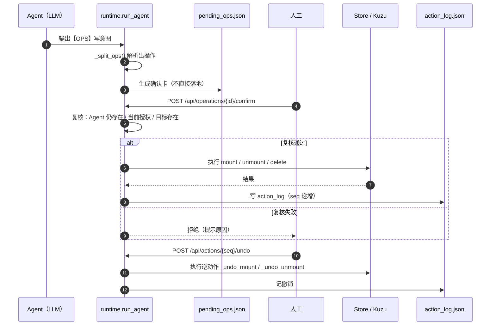

---

## 8. 备份与恢复（保护「不入库但很贵」的数据）

```bash
python scripts/backup_data.py           # 备份 kg/ + warehouse/ + core 元数据 → _backup/<时间戳>/
python scripts/backup_data.py --list    # 列出现有备份（默认保留最近 3 份）
```
恢复：停服 → 用备份覆盖 `app/data/kg/`、`app/data/warehouse/` → 启服 → `e2e_flow.py` 验收。
建议**停服后**备份（Kuzu/DuckDB 单写者，运行中复制可能拿到中间状态）。

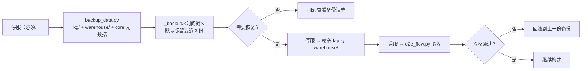

---

## 9. 关键文件索引

| 主题 | 位置 |
|---|---|
| 图库真值源 | `backend/app/store.py` |
| 数仓与进度/台账 | `backend/app/warehouse.py` |
| 本体模型与关系目录 | `backend/app/schema/ontology.py`（`REL_TYPES` / `REL_PAIRS`） |
| 单本编排与完整性 | `backend/app/ingestion/bookrun.py` |
| 抽取管线 | `backend/app/ingestion/pipeline.py` / `extract.py` / `rag.py` |
| 问答流水线（LangGraph） | `backend/app/graph/nodes.py` |
| 接地校验 / 动作与撤销 | `backend/app/ontology/verify.py` / `actions.py` |
| 主干抓取 / 派生 / 备份 | `backend/scripts/fetch_core.py` / `extract_core.py` / `backup_data.py` |
| 端到端冒烟 / 语义边修复 | `backend/scripts/e2e_flow.py` / `rebuild_seed_edges.py` |

---

## 10. 数据字典（字段级）

> 行数实测于当前实例 `C:\agent-history-data`；**行数随构建变化，结构稳定**。
> 想自己复核：`backend/scripts/_snap_size.py`（体积）、`_check_update_params.py`（写入语句参数一致性）。

### 10.1 Kuzu 图库（真值层，`kg/kuzu_db`）

| 表 | 行数 | 关键列 | 用途 |
|---|---|---|---|
| `Dynasty` | 84 | `id, name, span_s, span_e, color, cap_name, cap_lon, cap_lat, map_tile, grp, lane, emperors` | 朝代：起止年、都城经纬度、时间轴车道 |
| `Event` | 138631 | `id, name, year, month, day, date_conf, dynasty_id, lon, lat, place, actors, significance, dispute, route, route_label, from_book, book_sources` | 事件：时间/地点/参与者/重要性/分歧/行军路线 |
| `Person` | 61355 | `id, name, years, dynasty_id, home, lon, lat, aliases, from_book, book_sources` | 人物：生卒、所属朝、籍贯、别名 |
| `Place` | 2399 | `id, name, ancient, modern, lon, lat, aliases, external_ids, provenance` | 地名：9 条手工种子 + 2,390 条由事件派生（见 §10.10）。**`external_ids` 的值必须是字符串**，见 §10.14 |
| `Book` | 30 | `id, title, author, year, level, dynasty_id, span, tags, descr, extracts, mounted, origin, file, accepted` | 书籍：`level` 史料等级、`mounted` 是否已挂、`accepted` 已确认提案位图 |
| `Source` | 68 | `sid, owner, level, work, text, translation, confidence, from_book` | 引文：`owner` 指回宿主实体 id |
| `Institution` | 4 | `id, name, kind, function, dynasty_id, span_s, span_e, aliases` | 官制/机构 |
| `Artifact` | 3 | `id, name, kind, material, era_text, year, date_conf, place_id, museum` | 文物 |
| `Concept` | 4 | `id, name, kind, definition, dynasty_id, origin_year, aliases` | 制度/观念 |
| `KGREL`（关系） | 461815 | `rel, from_book, confidence, src_ids` | 唯一关系表；**端点由 `FROM/TO` 表决定**（8 种组合，见 `store.py:132`）。其中 18,718 条是 `Event-发生于->Place`（见 §10.12） |

- **关系名目录 24 种**：`app/schema/ontology.py:241` `REL_TYPES`——参与、任职于、师承、发生于、触发、奠定、书载观点、继承自、包含、隶属、设于、下辖、出土于、年代属、铭文录为、提及、创立、推行、盛行于、从属。
- **端点白名单**：同文件 `REL_PAIRS`（写边硬闸门 G1）。
- **JSON 列（以字符串存储）**：`span, tags, years, aliases, actors, route, book_sources, external_ids, extracts, accepted, emperors`。
- **列命名惯例**：`ca`=created_at、`ua`=updated_at、`version`=乐观锁、`provenance`=来源（seed/book）、`external_ids`=外部锚点 JSON（wikidata/cbdb/chgis/tgn/geonames）、`n_student/n_scholar/n_fan`=三种叙述口径。
- **`Book.extracts` 已不内联大书**：提案 >300 条时该列写 `[]`，真值源是 `data/ingest/<id>.json`，读取时回落（`store._artifact_proposals`）。原因：单本曾达 26 MB，Kuzu 扫描要整页 pin 住 → `buffer pool is full`，且写一半被强杀会留下坏 JSON 让服务起不来。

**图模式（边名即 `KGREL.rel`，端点即 `FROM/TO` 表）**：

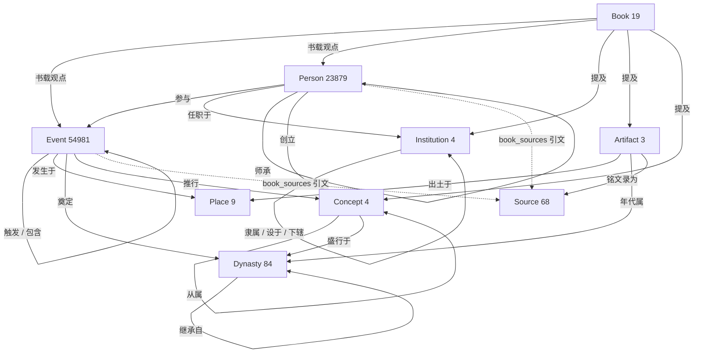

> 注：图内 `Place` 仅 9 条（主干 CHGIS 的 12.2 万地名在数仓 `core_places`，尚未导入图库）。

### 10.2 DuckDB 数仓（检索与台账层，`warehouse/chronosino.duckdb`）

| 表 | 行数 | 列 | 用途 |
|---|---|---|---|
| `chunks` | 36848 | `book_id, idx, text, char_start, char_end, token_count, embedding` | 原文切块（800 字/重叠 100）+ 512 维向量，RAG 检索 |
| `extract_raw` | 4344 | `book_id, piece_idx, model, payload, ts` | **LLM 原始返回，最贵**，产物可由此重出 |
| `ingest_progress` | 4347 | `book_id, piece_idx, model, n_persons, n_events, n_links, ts` | 块级进度（断点续跑依据） |
| `ingest_failures` | 411 | `book_id, piece_idx, model, kind, error, attempt, ts` | 失败台账（error/empty/fallback 三类） |
| `book_runs` | 20 | `book_id, stage, chunks, pieces, done, model, mode, proposals, mounted, updated` | 书级状态 |
| `book_run_params` | 19 | `book_id, signature, params, updated` | 参数指纹（改参数自动作废旧进度） |
| `core_persons` | 535180 | `id, name, year_birth, year_death, index_year, dynasty, female, external_ids` | 主干权威源（CBDB），**未进图** |
| `core_places` | 122075 | `id, name, modern, pinyin, kind, year_beg, year_end, external_ids` | 主干权威源（CHGIS），**未进图** |
| `core_anchors` | 12403 | `id, name, year_birth, year_death, external_ids(wikidata,cbdb), source` | Wikidata↔CBDB 锚点 |
| `entities` | ≈20 万 | `kind, entity_id, name, year, dynasty_id, place_id, lon, lat, from_book, confidence` | Kuzu 实体的**投影副本**，供时间窗/空间窗快查；起服全量重灌，之后按差异增量同步（`_sync_entities_to_warehouse`）。主键 `(kind, entity_id)`——**重复行会让整批 INSERT 失败**，见 §10.7 |
| `event_coords` | 18978 | `event_id, place, year, old_lon, old_lat, lon, lat, cbdb_addr_id, addr_name, addr_admin, addr_from, addr_to, how, batch, ts` | 地名 assimilation 的**证据与回滚依据**：每条写入的坐标都记下写入前的旧值，见 §10.8 |
| `place_nodes` | 2390 | `place_id, name, ancient, modern, lon, lat, aliases, external_ids, cbdb_addr_id, admin, beg_year, end_year, ref_events, batch, ts` | Place 节点的证据（含 CBDB 地址条目的起止年——图库没地方放这些），见 §10.10 |
| `event_place_edges` | 18714 | `event_id, place_id, rel, place, year, cbdb_addr_id, addr_name, how, confidence, via, batch, ts` | Event→Place 连边的证据与回滚依据，`via` 区分落到派生节点还是种子节点，见 §10.12 |
| `books_raw` | 0 | `book_id, title, author, level, stance, …, source_path` | 上传原文的登记台账（当前原文走 `books/` + manifest，不经上传） |

### 10.3 跨库关联键

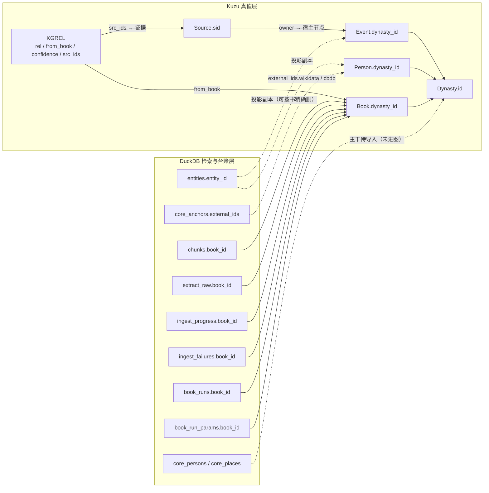

文字版：

- **图内**：`Event/Person/Book.dynasty_id → Dynasty.id`；`Source.owner → 宿主节点 id`；节点 `book_sources(JSON)[].sid → Source.sid`（G2）；`KGREL.from_book → Book.id`、`KGREL.src_ids → Source.sid[]`。
- **跨库**：`chunks / extract_raw / ingest_progress / ingest_failures / book_runs / book_run_params.book_id → Book.id`；`entities.entity_id → Kuzu 节点 id`（副本，可按书精确删）；节点 `external_ids.wikidata/cbdb → core_anchors.external_ids`。
- **主干**：`core_persons`（53.5 万）、`core_places`（12.2 万）已进数仓，**尚未导入图库**（图内 Place 仅 9 条）。

### 10.4 目录与散落文件用途

| 路径 | 用途 |
|---|---|
| `books/*.txt` + `books_manifest.json` | 27 本原文；manifest 是**书籍注册表**（id → file/title/author/span/tags/level） |
| `ingest/<id>.json` | 20 本**提案产物**，大书提案的真值源（挂载时读取） |
| `kg/kuzu_db` + `kg/dangling_edges.json` | 图库本体 + 29 条端点缺失的边 |
| `warehouse/chronosino.duckdb` | 数仓（§10.2） |
| `tiles/**` | 18.1 万张本地地图瓦片（离线底图） |
| `core/raw/**` + `core/normalized/*.jsonl` | 主干权威源原始件与精简表（raw 不入版本库，脚本可重下） |
| `merges.json` / `pending_ops.json` / `action_log.json` / `agents.json` | 实体合并记录 / Agent 待审批确认卡 / 动作日志（可 undo）/ Agent 注册表 |
| `book_scopes.json` | 扩展知识（策展书）名单——列进去的书**不入主干**，见 §10.6（文件不存在时只用内置名单） |
| `core/normalized/chgis_coords.jsonl` | 从 CHGIS 原始 ZIP 救回的 12.2 万条地名坐标（写盘前逐行校验不许错位），见 §10.8 |
| `core/normalized/event_coord_candidates.jsonl` | 地名 assimilation 的候选清单（`enrich_event_coords.py` 干跑产物，供人工抽查） |
| `core/normalized/place_node_candidates.jsonl` | Place 节点候选清单（`enrich_place_nodes.py` 干跑产物，含每个地点的被引用次数） |
| `emperors.json` / `maps.json` / `ontology_extra.json` / `seed.py` | 帝王表 / 底图配置 / 本体扩展 / 种子数据 |
| `_wmts_*.xml|json`、`_hm_*.html|json` | 瓦片服务能力与朝代页面的抓取缓存 |

### 10.5 构建现状快照

| 口径 | 数量 | 说明 |
|---|---|---|
| 原文 | 27 本 | `books/` |
| 提案产物 | 27 本 | `ingest/`（144 MB） |
| Book 节点 | 30 本 | 图库已登记（27 主干 + 3 策展） |
| **主干已挂载** | **27 本** | **26 史全部挂载完成**：史记、汉书、后汉书、三国志、晋书、宋书、南齐书、梁书、陈书、魏书、北齐书、周书、隋书、南史、北史、旧唐书、新唐书、旧五代史、新五代史、宋史、辽史、金史、元史、明史、资治通鉴、史通、读通鉴论 |
| 扩展知识（不挂载） | 3 本 | 万历十五年（二级·研究观点）、大秦帝国（三级·文学演绎）、丝绸之路（二级·研究观点） |
| 图库规模 | 边 461815 / 节点 202510 | 悬空边恒为 29（种子拼音 id 遗留，不影响查询）；其中 18,718 条是 Event→Place「发生于」；事件坐标覆盖率 13.7%（19,035 / 138,631） |

### 10.6 书库两层：主干 / 扩展知识

Book 有 `scope` 分层，**只影响能否挂载与是否进主干的意识层，不改变存储位置**：

| scope | 谁 | 能否挂载 | 挂载后去向 | 前端 |
|---|---|---|---|---|
| `canonical`（默认） | 27 本原文可读的正史/史论 | ✅ | 提案写入主干本体（Person/Event/KGREL），进时间轴·地图·图谱 | 主干书库栏 |
| `extended` | 3 本策展书（学术专著 / 历史小说 / 科普） | ❌ **硬闸门** | 不产生任何节点与边，只以观点卡片展示 | 扩展阅读栏 |

> 为什么分层：`extended` 的叙述是**观点而非史事**。把它们挂上去，小说里虚构的人物对话会变成与《史记》并列的可引用证据，
> 主干证据链（`book_sources` / `KGREL.confidence` / 闸门 G2）就不再可信。

**闸门位置（两道，缺一不可）**：`POST /api/mounts/start` 返回 400 挡住交互入口；
`Store.commit_book` 抛 `ValueError` 兜住脚本直连（`_build_all.py` / `run_book` 等路径）。

**为什么 scope 不落成 Kuzu 的列**：Kuzu 0.11 的 ALTER 只支持 RENAME/DROP，**不支持 ADD COLUMN**
（实测 `Invalid input <ADD COLUMN>: expected rule kU_AlterOptions`），而存量库已 7 GB、26 史全挂载，
为一列重建库不划算。因此判定放在 `backend/app/extended_books.py`：内置名单 + 数据目录
`book_scopes.json`（形如 `{"extended": ["某书id"]}`）——**以后新增策展书改这个文件即可，不用改代码、不动库**。
代价：`Store` 里凡是 `self.books` 被整体替换或新增的地方都要调一次 `_apply_scopes()`，
漏了就退化成 `canonical`（会允许挂载），目前四个入口（载入 / 冷启动 seed / 遗留 JSON / 恢复回收站）都已调。

### 10.7 本轮构建踩到的三个坑（都已修）

| 现象 | 根因 | 修法 |
|---|---|---|
| 《读通鉴论》挂载必现 500 | `Book.extracts` 把 26 MB 提案整包内联进节点，Kuzu 扫描要整页 pin 住 → `buffer pool is full` | 提案 >300 条不内联，真值源落 `ingest/<id>.json`，读取回落 |
| 《旧五代史》《新唐书》副本整本丢失 | 人物 id 就是名字（「王饶」），两本书各建一条同 id Person → 投影到副本主键冲突 → **整批 INSERT 失败** | `commit_book` 按 id 查索引，已存在就并入证据（`person_merged`）；副本写入前按 `(kind, entity_id)` 去重 |
| 《宋史》挂载 500（MemoryError） | `_label_index()` 每写一条边重建一次 9 万条目的 dict，49069 条提案 → 内存爆 | 索引改缓存 + 增量维护，实体增删时登记/作废；查不到时兜底重建 |

### 10.8 地名 assimilation（把坐标补进事件）

> 相关脚本：`extract_chgis_coords.py`（救坐标）、`enrich_event_coords.py`（写入，先干跑）、
> `verify_event_coords.py`（验证）、`rollback_event_coords.py`（回滚）、`place_match_probe.py`（口径评估）。
> 结果：Event 坐标覆盖率 **0.0% → 11.8%**（16,373 / 138,631），一致性 16,316/16,316，越界 0。

#### 为什么不能直接用 CHGIS

原本指望 `core_places`（12.2 万 CHGIS 地名）一上手就能给事件配坐标，实测这条路走不通：

| 问题 | 证据 |
|---|---|
| 它是**清代以降**的地名体系 | 益州 / 邺 / 朔方 / 云中 / 蓟 / 晋阳 / 建康 **完全没有**；成都只存在「成都县/成都府」 |
| 同名词条能差**上千公里** | 长安 6 个候选跨 1240 km、洛阳跨 763 km、新城 14 个候选跨 1409 km |
| 「京师」是陷阱 | 唯一候选是南京（起年 1378），而图上「京师」事件横跨公元前 344~1644 年 |

顺带补个历史债：当年 `extract_core.py` 派生时只挑了 name/pres_loc/years/type/data_src，
把坐标连同可回连的主键一起丢了，`chgis:N` 又是自增序号。后来靠 `main3.pt_id → gis_info.sys_id`
（命中 122,072/122,075 = 100%）把坐标救了回来，落 `chgis_coords.jsonl`。

#### 真正的源是 CBDB

`CBDB_20240208_sqlite.db` 里的 `ADDR_CODES` / `ADDRESSES`：带 `c_firstyear/c_lastyear` 年代区间、
`c_alt_names` 别名、层级归属，时代与 26 史对口。两个坑：

1. **全是繁体**——长安 0 条 / 長安 11 条。装 `zhconv` 做双向繁简归一后，采用率 16.9% → 38.8%。
2. **同名异地**——用「每个事件用自己的年份挑候选」+「坐标跨度 ≤0.5° 视为同地」+「行政级别兜底」三条判据。

#### 匹配口径（宁缺毋滥）

| 档位 | 判据 | 事件数 |
|---|---|---|
| `ok_year_unique` | 同名唯一候选，且事件年份落在它的年代区间 | 12,746 || `ok_year_same_place` | 多条候选落在窗口但坐标几乎重合（≤0.5°） | 3,424 |
| `ok_year_by_rank` | 仍多条时按行政级别取最高且唯一 | 146 |
| `blocked_movable` | **都城通称拉黑**（京师/京城/中都/上都/东京/西京/行在…） | 2,575 |
| `out_of_window` | 该地名在 CBDB 里没有覆盖那个年代（多为先秦） | 28,637 |
| `miss` | 词表里没有（多为小地名、非行政地名） | 40,062 |

**都城通称为什么整类拉黑**：CBDB 给「京师」一条 1368~1643 的坐标（北京），但明初（1368~1420）
定都南京——候选里 305 条「京师」就有 1368、1369、1370 这些年份，照写就是 330 条起步的错数据。
同理「中都」1153 年（金中都=北京）被标到山东汶上。

#### 安全基线（改动前必做）

- **冷备份**：停服后拷贝，`C:\agent-history-backup\20261006-baseline`（8.3 GB），
  并**验证过能真的打开**（备份库节点/边计数与线上逐一相符）——没验证过的备份不算备份。
- **证据留痕**：Kuzu 0.11 不支持 ALTER ADD COLUMN，没法给 Event 加「坐标来源」列，
  于是证据落在数仓 `event_coords` 表（含写入前旧值）。
- **幂等 + 可回滚**：重跑自动跳过已写的；`rollback_event_coords.py` 依据证据表一键还原。
- **校验兜底**：派生坐标时对错位极度敏感——12 万行里跳过一行就会全盘错配，
  所以用「行数 + 逐行 name/id 比对」卡死（实践中确实抓到了一次行数不符、一次排序用错字符串序）。

### 10.9 人物籍贯：评估过，结论是**不写入**

同一套思路试过给 Person 补籍贯坐标，**中途叫停**，理由记录在此以免有人重来一遍：

1. **现成的 `Person.home` 字段不可用**：61,355 个人物里它**去重后只有 14 个值**，
   且是早期手工备注（「邯郸出生，咸阳执政」「沛国谯县（今安徽亳州）」），不是可匹配的地名。
2. **CBDB 有 `BIOG_MAIN.c_index_addr_id`**（籍贯/基本地址），干跑能覆盖 10,731 人（17.5%），
   但抽查即翻车：**诸葛亮被标到成都**（CBDB 把他在蜀汉的执政地当籍贯），
   **曹操标到洛阳**（真正籍贯是沛国谯县＝安徽亳州）。
3. **定量评测**（`scripts/person_golden_test.py`：13 位史有定论的名人做考题，容差 120 km）：

   | 取值策略 | 准确率 |
   |---|---|
   | A 直接用 CBDB `c_index_addr_id` | 6/13 → **46%** |
   | C 祖籍/出生地/本貫/落籍/戶籍/前住地 优先，基本地址兜底 | 8/13 → **62%（最优）** |
   | D 基本地址优先、其余兜底 | 6/13 → 46% |
   | B 只用祖籍/本貫/出生地（覆盖极少） | 1/13 → 8% |

   错例：曹操 324 km、杜甫 312 km、李白 360 km；欧阳修用 A 策略偏 818 km（用 C 则 3 km）。

**结论**：最优策略也只有 62%，即每 3 个人就有 1 个错，且错的偏偏是最显眼的核心人物。
错误坐标比缺坐标更危险（地图上"看起来有数据"最难被质疑），因此**一个字都没写**
（已确认图库 Person 有坐标的仍是原先那 13 条）。

脚本留在 `scripts/enrich_person_coords.py`（干跑/证据/回滚机制与事件版一致，
只是 docstring 里写了"不要 --apply"的警示）与 `person_golden_test.py`（量化评测工具）。
若将来引入更权威的籍贯源（如 Wikidata 的 place of birth、CBDB 更细的地址类型），
改完后先跑黄金集，**过 90% 再开闸**。

### 10.10 Place 节点：给图补上地点这一层（2,037 个）

图库原本只有 **9 个 Place**（都城/遗址的手工种子），地点一直没有实体化的第三层。
本轮从 CBDB 补了 **2,037 个**，图内 Place 达 **2,046 个**。

**候选范围**：只收录**被图上事件引用到**的地址条目——判定口径与事件坐标完全一致
（同名 + 繁简归一 + 事件年份落在地名年代区间），所以每个新建 Place 背后都有至少 1 条
真实事件支撑，不会出现凭空冒出来的孤立地点。

| 校验项 | 结果 |
|---|---|
| 缺坐标 | 0 个 |
| id 重复 | 0 个 |
| 与 9 个种子同名（会产生两个「长安」） | 0 个 |
| JSON 列（aliases / external_ids）解析失败 | 0 次 |
| 与副本一致性 | 图库 2,046 ↔ 副本 2,046 ↔ 证据表 2,037 |

两处刻意的"抠门"：

1. **同名同坐标自动合并**：CBDB 里「长安」有 618~907 / 703~747 / 748~959 三条不同
   年代、坐标一模一样的条目，照单全收会在前端出现三个长安。按 `(简体名, 坐标)`
   合并成 1 个，年代取并集，累计合并掉 826 条。
2. **与种子同名一律跳过**：种子节点的 `ancient` 列存的是历代称谓串
   （北京＝蓟 / 幽州 / 范阳 / 中都 / 大都 / 京师），比 CBDB 单条更全，保留种子优先。

**Kuzu 不能加列带来的取舍**：地名条目的起止年无处可放（见 §10.6 的 ALTER 限制），
所以 `beg_year/end_year` 只进数仓 `place_nodes` 表，图库里靠 `external_ids.cbdb` 反查。

### 10.11 踩到一个隐藏很深的写入性能陷阱（50 分钟 → 1 秒）

修完坐标后跑副本重灌，20 万行跑了 20 分钟还没完。抽丝剥茧的结论出乎意料：

| 假设 | 实测 |
|---|---|
| 索引/主键拖慢写入 | ❌ 错了：全裸表（无 PK 无索引）也是 52 行/秒 |
| 磁盘慢 | ❌ 错了：顺序写 2.6 GB/s；Defender 实时保护本就关着 |
| 每条语句一个事务 | ❌ 错了：改成单事务后仍是 68 行/秒 |
| 批量 VALUES 能救 | ❌ 错了：200 / 1000 / 5000 行每批，全都 ~65 行/秒 |
| **Python 参数绑定本身慢** | ✅ **就是它**：~65 行/秒，每行 15 ms |
| 让引擎自己装载（JSONL + read_json） | ✅ **192,305 行/秒**，快 3000 倍 |

本机 DuckDB 1.5.6 + Python 客户端下，`executemany` 和「拼接 VALUES」都退化成逐行开销。
于是把三处批量写（`replace_chunks` / `replace_entities` / `upsert_entities`）
统一改走 `Warehouse._bulk_insert()`：**行写成临时 JSONL → read_json 显式列类型装载**。

效果：副本重灌 199,995 行从 **~50 分钟 → 1 秒**。这同时解释了"服务为什么启动那么慢"——
起服时的 `replace_entities` 走的就是这条慢路径，而今没有了。

> 提醒：新表要走 `_bulk_insert` 必须先登记到 `Warehouse._SCHEMAS`（列 + 类型），
> 类型是显式给的，不用 `read_json_auto` 推断——避免 NULL 列被推成奇怪类型。

### 10.12 把 Place 接进图：(Event)-[:发生于]->(Place)

> 相关脚本：`link_event_place.py`（干跑 → 写入）、`verify_place_links.py`（校验）、
> `rollback_place_links.py`（还原）。结果：**18,714 条新边**，图上合计 18,718 条（含 4 条
> 手工老边），坐标一致性 18,718/18,718，2,390 个派生 Place **全部连通、零孤儿**。

补完坐标（§10.8）和 Place 节点（§10.10）后，两者之间仍然**没有任何边**——
Place 是图上的孤岛（写入前出入边合计只有 11 条，全是手工种子）。而 `Event.lon/lat`
在 schema 里明确写着「由 `(Event)-[:发生于]->(Place)` 派生」，缺了这条边，
「长安发生过哪些事」这种问题答不了，空间层只是散落的浮点数字。

**不重算任何坐标**：判定完全沿用前两步已落地的证据表，所以本步不可能引入新错配。

| 落点 | 条数 | 怎么定的 |
|---|---|---|
| 派生 Place（`place:<addr_id>`） | 13,818 | 按 `place_nodes.cbdb_addr_id` **以及 `external_ids.cbdb_all` 别名数组**反查 |
| 既有种子 Place（拼音 id） | 2,498 | 名字精确匹配 + 坐标校验（≤0.5°）：长安→`changan` 1,762 / 洛阳→`luoyang` 506 / 南京→`nanjing` 227 |
| 未解析 | 0 | — |

两个坑与实践结论：

1. **只按主 `cbdb_addr_id` 反查会漏 2,498 条**。Place 建点时把同坐标同名条目合并了
   （如长安的 618~907 / 703~747 / 748~959 三条合成一个），合并掉的 id 留在
   `external_ids.cbdb_all` 里。实测：主 id 只能对上 10,524 条，展开别名数组后 13,818 条。
2. **三座都城得单列处理**。长安/洛阳/南京各有上千条事件，但 §10.10 定过
   「与种子同名一律跳过」，所以它们没有 `place:N` 节点，必须由这一步按名字接到
   已有种子上（种子 `ancient` 列存着「蓟 / 幽州 / 范阳 / 中都 / 大都 / 京师」等比 CBDB
   更全的称谓串，保留种子是对的）。接之前过了坐标校验这道闸，防止同名异地错连。

**安全**：默认干跑、`--apply` 才写；`from_book` 留 NULL（这一层不属于任何一本书，
卸载书籍时由 `DETACH DELETE` 一并清掉）；证据落数仓 `event_place_edges`，
`rollback_place_links.py` 按 batch 还原，且**只删本脚本写过的边**——手工种子那 4 条
老边（如 `yangshao_rise -发生于-> yangshao_v`）不在证据表里，不受影响。

> 小注：`event_place_edges` 的写入走的是逐行绑定（16k 行约 7 分钟，见 §10.11 的
> 3000 倍陷阱）。一次性运维脚本，先留着；若以后常跑，再登记进 `Warehouse._SCHEMAS`
> 改走 `_bulk_insert`。

### 10.13 放宽年代窗口：多要 811 条坐标，顺带查出 CBDB 自己的错坐标

> 相关脚本：`crosscheck_coords.py`（CHGIS 交叉验证）、`hierarchy_audit.py`（CBDB 隶属关系体检）、
> `collision_audit.py`（坐标撞车）、`repair_bad_coords.py`（清退坏坐标）。

严格档占到有地名事件的 **18.3%** 就到顶了，卡点是有 28,637 条事件「该地名在 CBDB 里
没有覆盖那个年代」。试了三条加量的路，**只有放宽年代窗口有效**：

| 加量手段 | 增益 | 结论 |
|---|---|---|
| 补 `ADDR_XY` 的坐标给缺坐标词条 | +3 条 | 无效——这些词条本来就没有任何事件引用 |
| 把 `ADDRESSES` 的 5.1 万条写法也纳入检索 | +2 条 | 无效 |
| **放宽年代窗口**（同名唯一候选 + 年代相差 ≤N 年） | gap≤200：**+847**；gap≤500：+1,771 | 唯一有效，但必须设闸 |

**不能一放了之**——按年代差分层的抽样显示错误集中在尾巴上：gap ≥400 年的样本
20 条里错 5 条（`金川`→四川金川、`安西`→甘肃会宁、唐代安西应是龟兹、`昌江`1427
应是越南）。所以最终口径是 **gap ≤ 200 + 都城/别名黑名单 + 只认有真实年份的事件**，
并按**地名维度**（而不是按事件）把涉及的 239 个名字逐个复核了一遍——坏地名会成串
重复，抽样估不准真实错误率。

这一轮把判定名单抽到了 `app/geo_rules.py`（此前散在各脚本里各写各的，导致写死简体的
黑名单遇繁体写法「京師」整个漏判，差点把 1054 年北宋开封的日食事件写到明代北京）。

#### 顺带查出 CBDB 自己的坐标错误（清退 25 条）

写了三份审计交叉印证，最后发现四处 CBDB 数据本身的问题，**没有可靠坐标就不写了**
（宁缺毋滥，与 §10.8 一脉相承）：

| CBDB 条目 | 实际被写成 | 应该在哪 | 影响 |
|---|---|---|---|
| `4042`《益州》 | 125.49,44.86（吉林） | 成都 104.07,30.67 | 1 条 |
| `3403/11167/14971/17162`《登州》 | 112.08,32.68（河南邓州） | 山东蓬莱 120.74,37.80 | 15 条；「渤海靺鞨寇登州」全错 |
| `4257/11888/15418/301033`《營州》 | 116.09,38.44（河北河间） | 辽宁朝阳 120.45,41.57 | 9 条；「契丹寇营州」「安禄山任营州刺史」全错 |
| `12743`《安國》 | 119.72,30.32（杭州） | —— 该事件「张安国杀耿京」是**人名被误当地名** | 1 条 |
| `12987`《永興軍》 | 115.21,29.83（湖北兴国军/阳新） | 长安（五代永兴军治所） | 10 条；「赵思绾叛永兴」全错 |

发现手段（三份脚本各自的价值与局限）：

- **`collision_audit.py`**：查「同一坐标被多个不同地名共用」——登州/鄧州、營州/河间
  就是这样露的马脚。局限：长安/京兆府、成都/蜀郡、南京/应天这类**同地异称**也会命中，要人工分辨。
- **`hierarchy_audit.py`**：用 CBDB `ADDR_BELONGS_DATA` 查「子政区坐标不应远离父政区」。
  局限：父坐标为 `0,0`（缺失）或父本身错误时会误报。
- **`crosscheck_coords.py`**：用救回来的 CHGIS 坐标交叉验证。局限最大——CHGIS 是清代切片，
  辽金时期的北方地名（顺州、广宁、柳城、惠州、锦州…）会被大量误报，报警的其实是 CHGIS 自己。

清理由 `repair_bad_coords.py` 统一做：同时退掉 **Event 坐标 + Place 节点 + 连边 + 三张证据表
里对应的行**，只清一样就会留下脏碎片。注意别按名字一刀切：`4945《登州府》`的坐标是对的（蓬莱），
那 19 条明代事件保留——所以是按 **addr id** 精确清退，不是按名字一刀切。

> 残余风险：已落的所有坐标都通过了「严格档 / 放宽档」判定，抽查 68 条（程序 + 人眼）
> 尚未发现新的系统性错误。但 CBDB 仍有未知比例的错误坐标，这三个审计脚本就是以后
> 继续挖的工具——发现新的就加进 `geo_rules.BAD_ADDR` 再跑一次清理。

### 10.14 一个几乎漏网的坑：Place.external_ids 的值必须是字符串

这一轮最后做的**端到端验证**（起服务真查一遍）救回了一次事故：写 Place 节点时把

```json
{"cbdb": "15099", "cbdb_all": ["15099", "3520", "12278"], "admin": "Xian"}
```

写进了 `external_ids`。这一列在图库里是 **STRING（存 JSON 文本）**，而 `Place` 模型
声明 `external_ids: dict[str, str]`；store 载入时 json.loads 后交给 pydantic，结果
**服务崩在 `Store.__init__`**——一个坏节点能把整个服务拉不起来，而这批节点有 2,159 个。

- **没有放宽 schema**：那是 STRING 列，store 回写 Kuzu 时同样会炸，改 schema 只是把
  崩溃推迟到写环节。
- 改的是写入端（`enrich_place_nodes.py` 用逗号串：`"cbdb_all": "15099,3520,12278"`），
  消费端（`link_event_place.py`）两种形态都收得下，存量节点用
  `repair_place_external_ids.py` 改回来，并按 store 的口径自检（2,168 个节点 0 失败）。

**教训：离线写好数据不算完，起服务跑一遍才算。** 前面几轮的入库校验都在脚本层面
（证据一致性、坐标范围、模型校验），没人站在 store 的入口上看一眼。以后凡是往图库
写新节点/新边，最后一环固定是：起服务 → `/api/health` → `/api/kg/schema` →
按这次改的维度查一次接口。

### 10.15 后缀归一化：再补 1,877 条坐标（覆盖率 12.4% → 13.7%）

还有约 4 万条事件对不上 CBDB 词表，其中一大类是**书写差一个行政后缀**：图上写
「河东郡 / 河中府」，CBDB 词条叫「河東 / 河中」；图上写「建康」，词条叫「建康府」。
于是加了一档 `suffix_*`：剥后缀 / 补后缀各试一遍，但**判据与严格档一样硬**（年代窗口
+ 坐标唯一），且变体之间一旦给出不同坐标就算歧义。

结果：新增 **1,877 条事件坐标 / 231 个 Place 节点 / 1,616 条连边**。

这档特有的红线（写在 `geo_rules.py`，四条一起）：

| 红线 | 为什么拦 |
|---|---|
| **单字地名不猜**（汉/赵/元/河/蜀） | 「汉」在图上多半指汉朝或汉水，CBDB 却只有《汉州》（四川广汉） |
| **省级/大区名不写**（广东/甘肃/西北/江南…） | 会被同名的州/卫/路带偏：`广东`→《廣東衛》(广州)、`西北`→《西北路》(阿尔泰)，误差以百公里计 |
| **卫所条目不采用**（admin=Wei） | 只有明清才有，且已发现《金齒衛》坐标错误（本该在云南保山，被填到内蒙古） |
| 带「省」字 | 现代省级单位的坐标其实是省会 |

同一轮里又揪出一个 CBDB 错坐标：`12987《永興軍》`的坐标其实是「鄂州永興县/興國軍」
（湖北阳新），而图上「赵思绾叛永兴」说的是五代永兴军（治长安）——10 条全错，已清退。

#### 人物籍贯：这条我们决定不做

原本想用同一套方法给 6.1 万个人物补籍贯坐标，**评估后放弃**，因为 CBDB 给不出可靠的籍贯：

| 人物 | CBDB 基本地址 | 真实籍贯 | 偏差 |
|---|---|---|---|
| 曹操 | 洛阳 | 沛国谯（亳州） | 324 km ✗ |
| 诸葛亮 | 成都（执政地） | 琅琊阳都（沂南） | 1,439 km ✗ |
| 杜甫 | 长安 | 巩县（巩义） | 377 km ✗ |
| 王安石 | 临川 | 临川 | ✓ |
| 苏轼 | 眉山 | 眉山 | ✓ |

而且**没有任何一类地址是籍贯**：诸葛亮的 type=3 是沂水（对），苏轼的 type=3 却是
一串任职地（错）。连曹操作者都会错，整类数据不可用——**错坐标比缺坐标危险**，
所以 Person 的坐标维持在原来的 13 条。留给以后：要么拿到更权威的源（如《中国历史
地图集》数字化的籍贯表），要么回到原文做「XX，YY 人也」的抽取。

#### 人物籍贯：改从原文抽（CBDB 不可靠，见上）

外部源判死之后，剩下唯一可靠源是原文——史书最有规律的一句就是「XX，YY人也」。
`extract_person_hometown.py` 的做法：扫数仓 36,848 条原文切片 → 句式正则抓
(人名, 籍贯短语) → 人名必须能对上图内 61,355 个 Person → 籍贯短语交给**与事件
坐标同一套**的地名词典解坐标 → 同一个人的多次出现坐标一致才采纳。

结果：**1,209 个籍贯 → 1,210 个 Person 节点**（图内有坐标的 Person 13 → 1,222）。
抽查 26 条逐个核对全对（李存孝→代州飞狐、杨绾→华州华阴、王虔裕→琅琊临沂、
辛恭靖→陇西狄道、郑韺→石康、林靈素→温州）。

两个关键取舍：

1. **放弃「就近关联」档**。史书开场常写「太祖武皇帝，沛国谯人也」——名字与籍贯
   不挨着，句式抓不到（黄金集 14 位名人召回为 0 就是这个原因）。补了一档
   「段内就近关联」（召回从 1,209 涨到 2,186），但抽样 26 条里错 5 条
   （`司空图`抓到「自言泗州」、`武兴`抓到「所以怀远」、`张彦泽`抓到「后为太原」、
   `严嵩`抓到「江宁」而他是江西分宜人）。噪声明摆着，所以默认只跑句式档
   （`--tiers both` 可临时打开）。
2. **卫所条目不采用**（与事件同源的教训）：「颍川」被解到《潁川衛》(安徽阜阳)，
   汉代颍川郡在禹州。

另外发现图里**同一个人有多条 Person 实体**（手工种子 `caocao` 与挂载副本 `曹操`），
所以坐标按**名字**赋给所有同名节点，而不是只给抽到的那一条。

#### 一个已知缺口（不打算强行补）

同名但坐标不同的 Place 会被当成两处（这是对的），代价是若干事件**有坐标但没有 Place 边**：
如「凤翔」存在 107.39,34.52（凤翔县）与 107.14,34.38 两组坐标，相差 28 km，
后者不单独建节点，于是它引用的 163 条事件缺 `发生于` 边。
这些事件在地图上照常显示（地图用的是 `lon/lat`，不是 Place 节点），
缺的只是「某地发生过哪些事」的反向查询——比把两个相差 28 公里的点并成一处更可接受。
