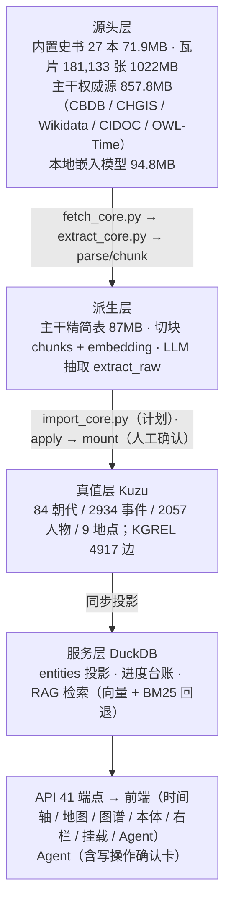

# ChronoSino 构建指南：原理 · 实操 · 用途

> 回答三个问题：**为什么这么设计**（原理）、**怎么一步步建起来**（实操）、**建完能干什么**（用途）。
> 配套文档：`PLAN.md`（总体方案）、`BUILD.md`（逐步操作细节）、`ONTOLOGY_ALIGN.md`（外部本体对齐与闸门）、`DATA_LINEAGE.md`（数据血缘与存储分工）。

---

# 第一部分 · 设计原理

## 1.1 主干与扩展：知识分两层

这是认识论问题，不是技术偏好。

| | 权威源（CBDB / CHGIS / Wikidata / CIDOC / OWL-Time） | 书籍（《史记》《二十四史》《资治通鉴》…） |
|---|---|---|
| 性质 | 学界校勘后的**结构化事实** | **单一史观的记述** |
| 可靠性 | 多源交叉验证、可复现 | 可能讹误、有立场、彼此矛盾 |
| 形态 | 「刘邦，前 256–前 195」 | 「《史记》载：沛公…」 |

本体论对应：**TBox / ABox 分层 + 陈述具体化（statement reification）**。
- 主干 = 受控的模式层与核心事实（刘邦是人、生卒、属汉）
- 书籍 = 挂在实体上的**带出处的断言**（"《史记》说 X"），不是事实本身

因此书籍**从不直接写入事实**，只挂载观点，且**并列而非覆盖**（G4）。这就是为什么《史记》挂载后产生的是「书载观点」边，而不是改写实体属性。

## 1.2 `external_ids`：解决"是不是同一个人"

知识工程最硬的问题是**指称消解**。同一个"刘邦"在系统里有四种叫法：

```
CBDB          liubang / c_personid=12345
Wikidata      Q7122
《史记》抽取   中文名 id "刘邦"
本系统         Person(id="刘邦")
```

没有外部 id，系统只看到四个互不相关的字符串，**无法判断它们是不是同一个**——这就是符号接地问题。

`external_ids` 把本地符号锚定到公共参照系（本体论里即 `owl:sameAs`）：

```json
{"cbdb": "12345", "wikidata": "Q7122"}
```

有了它：跨源核对才可能；**冲突才可判定**（否则"A 说前 256、B 说前 247"只是两个孤立字符串）；去重、合并、消歧才有依据。这是 G5 闸门的物理基础——**没有这个字段，G5 只是文档里的口号**。

## 1.3 `origin`：冲突时谁说了算

不同来源的信念强度不同（**可废止推理**）：

```
core（权威源）  >  book（单一史料）  >  LLM 抽取
```

规则：**书永远不能静默覆盖主干**，只能并列 + 标 `dispute` + 进 `needs_review`。
`origin` 就是这个优先级的可计算标记，对应溯源标准 **PROV-O 的 `wasDerivedFrom`**——每条知识带"我从哪来"，才能审计、裁决、撤销。

## 1.4 存储分工：为什么 53 万人物不进图库

两个存储的收益函数完全不同：

```
图库（Kuzu）    收益 ∝ 关系遍历；代价：每节点/每边都占空间，且 save() 全量重写
列存（DuckDB）  收益 ∝ 筛选/聚合；代价几乎为零，53 万行 SQL 查询毫秒级
```

关键洞察：**孤立节点的图价值为零**。53 万 CBDB 人物若全进图库，一条边都没有，图的收益是 0，代价却全付了（`save()` 从秒级变分钟级）。

正确做法是**按需物化（lazy materialization）**：

```
53 万人物 → DuckDB（随时按姓名/朝代/年份筛）
              ↓ 只有"发生了关系"的（有锚点、和已挂载实体对上了）
           Kuzu（才真正成为图节点）
```

这与 Ontop「虚拟知识图谱」同源：**底表留在关系库，只把需要参与关系的实体提升为图节点**。

## 1.5 图的价值在边的语义密度

**图数据库的本质：价值 ∝ 边的语义密度，不是节点数。**

现状：
```
4917 条边，rel 只有一种「书载观点」
= 所有实体只连到《史记》这一个 hub
= 图退化成一颗星，等价于倒排索引
```
这样的图谱回答不了「谁发动了哪场战役」，只能回答「《史记》提到了谁」。

补上语义边后（发动 / 败于 / 建立 / 出使 / 统军 / 派遣 / 辅佐…），网络才真正成立，可做路径查询与关系推理。本体论里这就是 **object property assertions**——只有类定义而缺少属性断言，实例不成网络。

## 1.6 悬空边：引用完整性

关系库有外键约束，图库（Kuzu）**没有自动引用完整性**——写一条边不检查两端节点是否存在。于是：

```
seed 边用拼音命名空间   xiangyu → gaixia
书抽取用中文命名空间     项羽   → 垓下之战
两套 id 体系从未对齐 → 写入时端点检索不到 → 29 条边悬空
```

根治靠两件事：
1. **别名解析**：`id → 名称 → 名称分段` 逐级匹配（`xiangyu` → "项羽" → 命中库里节点）
2. **写入前校验**：SHACL shapes 或 `REL_PAIRS` + 端点存在性检查，把"静默失败"变成"显式报错"

实测：pySHACL 用真实 29 条悬空边构造数据图，**17 ms 报出 8 条违规**（如 `ex:zhangqian --出使--> ex:zhangqian_ev: Value does not have class ex:Event`）。从人肉发现变成规则自动发现。

## 1.7 语义网五层架构对照

| 层次 | 标准说法 | 本项目实现 |
|---|---|---|
| 标识层 | URI / `owl:sameAs` | `external_ids`（cbdb / wikidata / chgis / tgn / geonames） |
| 溯源层 | PROV-O `wasDerivedFrom` | `origin`（core / seed / book）+ `from_book` + `src_ids` |
| 模式层 | OWL 类 / 属性 / domain·range | `REL_TYPES`（23）+ `REL_PAIRS`（41）→ 可导出 SHACL |
| 断言层 | 带 provenance 的 statements | Kuzu 节点与 KGREL 边（含 `Source` 引文） |
| 校验层 | SHACL / 约束 | G1–G5 闸门 + SHACL（已验证可用） |

---

# 第二部分 · 系统构成



**一句话**：Kuzu 存「是什么」（实体与语义关系，真值源），DuckDB 存「怎么来的」（原文切块、LLM 抽取、进度台账）与检索副本；权威源是主干，书籍是挂在主干上的扩展知识。

---

# 第三部分 · 从零构建实操

## 阶段 0 · 环境

```powershell
# Windows 控制台需 UTF-8；PATH 上的 python 可能是坏的 uv trampoline，用 venv 解释器
$env:PYTHONIOENCODING = 'utf-8'
d:\src\agent-history\.venv\Scripts\python.exe -m pip install -r backend/requirements.txt
```

> 坑：若 `pip install` 报 `WinError 448 不受信任的装入点`，是 PATH 里混入了 reparse point
> （本机是 `C:\Users\40108\.g\go\bin`）。临时剔除该段再装：
> `$env:PATH = ($env:PATH -split ';' | Where-Object { $_ -and $_ -notlike '*\.g\go*' }) -join ';'`

## 阶段 1 · 启动与验收

```powershell
powershell -ExecutionPolicy Bypass -File scripts\serve.ps1            # 后端 :8000
powershell -ExecutionPolicy Bypass -File scripts\serve.ps1 -Frontend   # 再加前端 :5173
powershell -ExecutionPolicy Bypass -File scripts\serve.ps1 -Stop       # 停服

cd backend
..\.venv\Scripts\python.exe scripts\e2e_flow.py --book shiji           # 只读冒烟（21 项）
..\.venv\Scripts\python.exe scripts\e2e_flow.py --book shiji --chat    # 连对话与接地校验
python scripts/selftest_ingest.py                                      # 解析与 RAG 自检
```

验收标准：全部 PASS。`e2e_flow.py` 覆盖 health / books / queue / timeline / events / search /
entity / kg/schema / kg/nodes / graph/query / kg/whole / maps / ontology / actions / agents。

## 阶段 2 · 本体主干本地化

```powershell
cd backend
..\.venv\Scripts\python.exe scripts\fetch_core.py            # 五源并发抓取（断点续传）
..\.venv\Scripts\python.exe scripts\fetch_core.py --discover # 只探测可达性
..\.venv\Scripts\python.exe scripts\extract_core.py          # 派生精简表 → core/normalized/
..\.venv\Scripts\python.exe scripts\import_core.py --load    # 计划：主干大表 → DuckDB
..\.venv\Scripts\python.exe scripts\import_core.py --link    # 计划：已对齐实体 → Kuzu
```

产出：`core_persons`（535,180 人）/ `core_places`（122,075 地名）/ `core_anchors`（12,403 锚点）；
图谱只连「有锚点或能与已挂载实体对上」的实体，冲突进 `needs_review`，**不自动合并**。

## 阶段 3 · 单本书入库（以《史记》为例）

**离线（推荐，需停服）**
```powershell
python scripts/ingest_one.py shiji --llm --repair --max-rounds 3 --strict `
       --retry-rounds 3 --reset-failed --no-store
python scripts/ingest_one.py shiji --status --no-store     # 看缺口（缺/空/退/错）
```

**在线**
```bash
POST /api/ingest/{book_id}          # 后台单任务，409 表示已有任务在跑
POST /api/ingest/{id}/apply         # 接回线上
POST /api/mounts/start              # 看 warnings（coverage<100% 会提示）
POST /api/mounts/commit             # 人工确认后写入图库
GET  /api/books/queue               # 队列与进度
```

## 阶段 4 · 加第二本及以后（叠加，不重建）

```powershell
# ① 停服离线抽取
python scripts/ingest_one.py 资治通鉴 --llm --repair --max-rounds 3 --strict
# ② 启服后 apply → mounts/start → mounts/commit
# ③ 可选：新实体与主干对齐
python scripts/import_core.py --link
# ④ 验收
python scripts/e2e_flow.py --book 资治通鉴
```

事件在 `commit_book` 时按年份用 `dynasty_at(year)` 自动归朝，所以《资治通鉴》这类跨十余朝的通史
也能正确落位；同一事件多书记载并列 + `dispute`，不覆盖。

## 阶段 5 · 语义层（待落地，已验证可行）

```powershell
python scripts/export_owl.py        # 计划：ontology.py → chronosino.owl（含 CIDOC/OWL-Time 映射）
python scripts/validate_shacl.py --all   # 计划：全量体检（自动报悬空边/类型不匹配）
python scripts/probe_ontology.py    # 已可用：本体工具自检（外部本体解析、shapes 生成、违规检出）
```

实测数据：CIDOC CRM OWL 6908 三元组 / 76 类 / 290 属性（0.2s，E21/E5/E53/P11 全命中）；
OWL-Time 1296 三元组 / 23 类（`time:Interval` / `time:Instant` / `time:TemporalEntity`，**无 TimeSpan**）；
从 `REL_PAIRS` 自动生成 184 个 SHACL shape；SHACL 校验 1000 边 0.15s / 1 万边 2.2s / 5 万边 21s
→ **只在写入闸门跑，不放查询路径**。

## 阶段 6 · 修语义边（待执行，需停服）

```powershell
python scripts/rebuild_seed_edges.py           # 干跑：统计可解析/悬空
python scripts/rebuild_seed_edges.py --apply   # 写入（先做好备份）
```

端点按 `id → 名称 → 名称分段` 解析（`xiangyu` → "项羽"），使 KGREL 的 `rel` 从 1 种变成 20+ 种。

---

# 第四部分 · 质量保障

**五道闸门**

| 闸门 | 作用 | 实现 |
|---|---|---|
| G1 | 写边必须过 `REL_PAIRS` 白名单（domain/range） | `store.add_edge` |
| G2 | 实体/事件必须绑定史料原文证据 | `Source` + `src_ids` |
| G3 | 回答中的年份/专名必须在原文出现（接地） | `app/ontology/verify.py` → `/api/chat` 返回 `grounding` |
| G4 | 同一事件多书记载并列 + `dispute`，不覆盖 | 挂载流程 |
| G5 | `external_ids` 与权威源比对，冲突进 `needs_review` | 依赖 `external_ids` 字段（落地中） |

**抽取完整性机制**（详见 `BUILD.md` §3.6）
单组隔离重试 · 失败台账（error/empty/fallback 三类）· 缺口计划 · `--repair` 多轮补齐 ·
收口合并全量 raw 不按 limit 裁剪 · **先落 raw 再记进度** · 产物保护（`keep_best`）·
参数指纹（改参数自动作废旧进度）· Ctrl+C 先收口再退出 · `--strict` 不完整退出码 2 ·
状态保护（小样本不冲掉已完成状态）。

---

# 第五部分 · 建完能做什么

## 5.1 界面

| 面板 | 能做什么 |
|---|---|
| 时间轴 | 按年份浏览 84 个政权与 2934 条事件，车道展示并立政权 |
| 地图 | 按朝代切底图（18.1 万张本地瓦片），叠加事件地点 |
| 图谱 | 浏览实体与语义边、子图展开 |
| 本体导航 | 按本体类型（朝代/事件/人物/地点…）浏览主干 |
| 右栏 | 详情、引文原文、书籍、Agent、架构图、问答 |
| 书籍挂载 | 上传 / 入库 / 抽取 / 应用 / 挂载全流程 |
| Agent 管理 | 注册 Agent、授权工具、审批写操作确认卡 |

## 5.2 问答（RAG + 接地）

`chunk(800/100) → ONNX bge-small-zh 512 维 → 向量检索（失败回退 BM25）→ LangGraph 节点
强制引用编号 [n] → /api/chat 返回 answer + evidence + grounding + warnings`。

G3 保证：回答里的年份与专名必须在史料原文中出现，否则给 `warnings`——**反幻觉是硬约束**。

## 5.3 Agent

- 只读工具：图谱浏览、RAG 检索、史料读取
- **写操作不直接落地**：生成确认卡 `pending_ops`，`POST /api/operations` 人工确认后才执行
- 可撤销：`POST /api/actions/{seq}/undo`
- 三者区别：`proposals` = 抽取提案；`pending_ops` = Agent 写操作确认卡；`actions` = UI 动作序列

## 5.4 典型问题（主干 + 书结合后）

- 「刘邦在哪一年称帝？《史记》怎么说，CBDB 记的生卒是多少？」→ 主干给锚点，书给原文证据
- 「垓下之战参与者之间的社会关系网」→ 语义边连通后可做路径查询
- 「这两本书对同一事件的记载冲突在哪」→ G4 并列 + `dispute`
- 「某地在清代叫什么、今地是哪里」→ CHGIS 122,075 条地名沿革

---

# 第六部分 · 数据资产与备份

| 类别 | 目录 | 体积 | 入库 | 重建代价 |
|---|---|---|---|---|
| 原始·瓦片 | `app/data/tiles/` | 1022.8 MB | ✅ | 极高（必须入库） |
| 原始·书 | `app/data/books/` | 71.9 MB | ✅ | 高 |
| 原始·模型 | `models/` | 94.8 MB | ✅ | 中 |
| 原始·主干大件 | `app/data/core/raw/` | 857.8 MB | ❌（CBDB 837 MB > GitHub 单文件 100 MB 硬限） | 中（`fetch_core.py` 按 manifest 重下） |
| 派生·主干精简 | `app/data/core/normalized/` | 87 MB | ✅ | 低（`extract_core.py`） |
| 构建·图库 | `app/data/kg/` | 658.7 MB | ❌ | 中高 |
| 构建·数仓 | `app/data/warehouse/` | 518.8 MB | ❌ | **高**（`extract_raw` 是 LLM 调用结果） |

```powershell
python scripts/backup_data.py           # 备份 kg/ + warehouse/ + core 元数据
python scripts/backup_data.py --list    # 列出现有备份（保留最近 3 份）
```
恢复：停服 → 覆盖 `app/data/kg/`、`app/data/warehouse/` → 启服 → `e2e_flow.py` 验收。

---

# 第七部分 · 常见坑

| 症状 | 原因 | 处理 |
|---|---|---|
| `python` 报 uv trampoline 错 | PATH 上的 python 是坏的 | 用 `.venv\Scripts\python.exe` |
| 中文乱码 | 控制台编码 | `$env:PYTHONIOENCODING='utf-8'` |
| DuckDB / Kuzu 加锁失败 | 服务未停（单写者） | 先 `serve.ps1 -Stop` |
| 服务起了但端口不通 | 图库加载约 50 s | 轮询 `/api/health` 等待就绪 |
| `push` 报 443 超时 | 外网间歇性拦截（DNS 轮换到被墙 IP） | 重试 / 换时段；已设 `core.compression=0` 加速打包 |
| GitHub 拒收大文件 | 单文件 > 100 MB | 大件走脚本重建或 LFS |
| Wikidata 抓取卡住 | 公共端点限流 | 减小 batch、分批；脚本有停滞检测与续传 |
| 「OWL-Time 的 TimeSpan 找不到」 | 该本体无 TimeSpan | 用 `time:Interval` / `time:Instant` / `time:TemporalEntity` |

---

# 附录 · 文档索引

| 文档 | 主题 |
|---|---|
| `docs/GUIDE.md`（本文） | 原理 + 实操 + 用途总纲 |
| `docs/PLAN.md` | 总体实施方案与分阶段路线 |
| `docs/BUILD.md` | 逐步构建操作细节、可靠性开关、排错 |
| `docs/ONTOLOGY_ALIGN.md` | 外部本体对齐、反幻觉四类闸门、`external_ids` 规范 |
| `docs/DATA_LINEAGE.md` | 数据血缘、存储分工、界面与 Agent 用法 |
| `app/data/core/SOURCES.md` | 主干数据来源、校验和、许可 |
